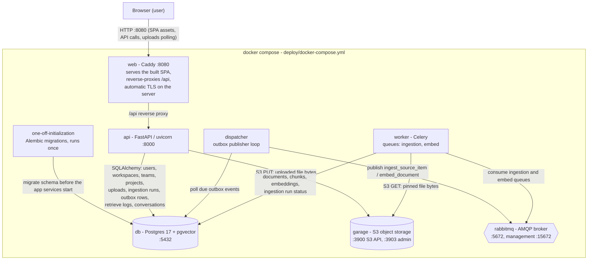
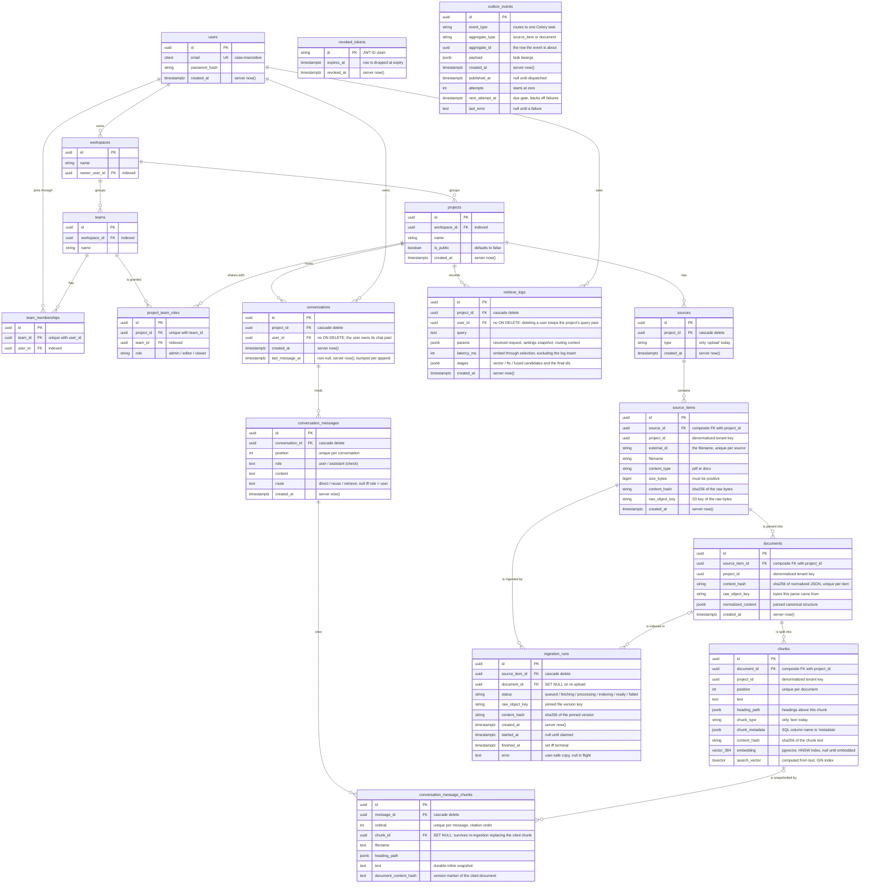

# System overview

Snapshot as of 2026-10-29, covering the service topology, the HTTP API, the
web UI shell, and the database schema. Sources: `deploy/docker-compose.yml`,
`backend/app/main.py` and the six routers it mounts, `web/Caddyfile`,
`web/src/app/api.ts`, the RTK Query feature APIs plus
`web/src/features/uploads/useProjectUploads.ts`, the app shell and its
project-scoped pages (`web/src/layouts/AppShell.tsx`,
`web/src/app/sectionPaths.ts`, `web/src/features/chat/ChatLanding.tsx`), and
the ORM models in `backend/app`.

## Service topology

### Services

#### db

Postgres 17 with the pgvector extension. It holds every domain table - identity,
projects, the sources and ingestion tree, the outbox queue, and the per-query
retrieval logs - and the chunks table carries the vector and full-text indexes
that retrieval queries.

#### garage

S3-compatible object storage (single-node dev mode, bucket `rag-dev`) holding the
raw uploaded bytes under `raw/{project_id}/{source_item_id}/{content_hash}/{filename}`
keys. The api PUTs bytes on upload; the worker GETs them on ingest and verifies
them against the pinned hash.

#### rabbitmq

The AMQP broker moving task messages from the dispatcher to the worker. Both
queues are durable so a broker restart cannot drop a queued message, and there
is no result backend - task outcomes live in Postgres on the ingestion runs.

#### one-off-initialization

A one-shot container that runs the Alembic migrations and exits. The api,
worker, and dispatcher wait for its successful completion before booting, so the
schema always exists before the app tier starts.

#### api

The FastAPI app under uvicorn, serving every HTTP route in this document. On
upload it PUTs the bytes into Garage and records the domain rows plus an outbox
event in Postgres; it never publishes to RabbitMQ itself - that is the
dispatcher's job (transactional outbox).

#### worker

The Celery worker consuming the `ingestion` and `embed` queues (concurrency 2).
Its tasks are thin wrappers over the ingestion services: fetch the pinned bytes
from Garage, parse, chunk, and embed them (stub providers today), then write
documents, chunks, embeddings, and run status to Postgres. Late acks re-deliver
a task whose worker died mid-run.

#### dispatcher

A standalone polling process (deliberately not Celery Beat) that scans the
outbox table for due unpublished events and publishes them to RabbitMQ through
the routing map in `app/outbox/events.py`, waiting for broker confirms. A
failed row is backed off one exponential interval so poison events cannot
starve the rows behind them.

#### web

Caddy serving the built SPA from the `rag-web` image. It reverse-proxies `/api`
to the api service so the browser path is same-origin (no CORS involved), falls
back to `index.html` for SPA routes, allows request bodies up to 26 MiB so the
25 MiB upload limit fits, and on the public server terminates TLS with
automatically managed certificates. There Caddy also serves HTTP/3 (QUIC over
UDP 443, published by the server compose override): browsers adopt it per-origin
once the first HTTPS response advertises it via Alt-Svc and fall back to TCP
transparently when UDP is unavailable, so clients with TCP-side path quirks can
ride QUIC instead. (The one known doubly-broken client - the owner's wired NIC
defeats both transports - is tracked in `docs/backlog.md`'s paused
investigation.)

The SPA itself is the official-MUI-template UI rebuilt on 2026-10-21 (branch
`ui-mui-templates`): every signed-in route renders inside one dashboard shell,
whose permanent sidebar (Projects, Sources, Chat active; Users and Analytics
disabled with "Coming soon" chips) and topbar project selector stay in sync with
the URL. The pages are project-scoped section routes: the projects list at
`/projects`, the source items at `/projects/:id/sources` with the "Add source"
menu (file upload active; Website and Google Drive "Coming soon"), the
file-upload dropzone at `/projects/:id/sources/upload`, and the chat page at
`/projects/:id/chat`; the bare `/projects/:id` redirects to its sources page.
The internal `/app` resolver funnels every signed-in entry (register, login,
and the signed-in landing redirect): it walks the user's projects newest-first
and lands on the first chattable one's chat, else the newest project's sources,
else `/projects`. A 2026-10-22 polish round (branch `ui-polish`) rebranded the
app to Loctapus with an octopus logo, rewrote the landing page's marketing
story, rebuilt the chat page on a ChatGPT-style composer, notched the outlined
inputs' floating labels, added a spinner to the upload status chip while the
pipeline runs, and turned source filenames into links that open the raw file
in a new browser tab. A 2026-10-23 round (branch `s6-multi-turn-conversations`)
gave the chat page a server-backed conversation: the panel hydrates the signed-in
owner's latest conversation in the project on mount (an empty thread while none
exists), threads every ask through the served `conversation_id`, offers a
"New chat" action, and renders each answer's persisted evidence snapshots as
source chips.

Runtime flow of one upload:

1. The UI POSTs the file to `/api/projects/{project_id}/uploads` under a 360s
   stall timeout (`UPLOAD_TIMEOUT_MS` in `web/src/features/uploads/uploadsApi.ts`),
   so a hung connection surfaces retryable network copy instead of leaving the
   upload button disabled forever. The API PUTs the
   bytes into Garage and records the upload, a queued ingestion run, and an outbox
   event in Postgres.
2. The dispatcher polls the outbox table and publishes due events to RabbitMQ
   (`ingestion` queue, then `embed`).
3. The Celery worker consumes the tasks, fetches the bytes from Garage, parses and
   chunks them (stub provider today), embeds the chunks, and writes documents,
   chunks, embeddings, and the run status to Postgres.
4. The UI polls the uploads list every 2s until every row is terminal, which is how
   pipeline progress reaches the page.

Runtime flow of one question:

1. The UI POSTs the query plus the hydrated `conversation_id` (null until the
   server serves one) to `/api/projects/{project_id}/answer`. The api resolves the
   conversation - null means the owner's latest in the project, else one pending new
   row - loads the last `answer_history_messages` history messages and the REUSE
   snapshot set, and closes the read before any LLM call.
2. The router LLM call (`route()`) decides the turn: `DIRECT` (answer from history
   alone), `REUSE` (answer from history plus the conversation's gathered earlier
   evidence), or `RETRIEVE` (a rewritten standalone query, fresh retrieval). A
   failed router call degrades to `RETRIEVE` with the raw question, logged on the
   retrieval row (`params.router_fallback`); the stub always retrieves so offline
   dev and e2e keep the S5 behavior.
3. `RETRIEVE` embeds the effective question (stub embedding provider today), runs the
   two search legs over the project's indexed chunks - pgvector cosine and Postgres
   FTS - fuses the candidates by reciprocal rank, and diversity-selects the final
   chunks, writing one `retrieve_logs` row (`params.origin=answer`, plus
   `route`/`raw_query`) - `direct` when the retrieval endpoint is called directly.
   `REUSE` answers grounded in the gathered snapshots; `DIRECT` needs no passages.
   An empty index answers from a canned sentence without an LLM call.
4. One transaction appends the user message, the assistant message (with its route),
   the evidence snapshot rows, and the `last_message_at` bump - creating the
   conversation itself only here on the null path, so a failed call persists
   nothing, not even an empty conversation. A row lock serializes concurrent turns.
5. The response carries the answer text, the route, the `conversation_id`, and the
   snapshots; the ChatPanel renders the answer with its source chips and adopts the
   served `conversation_id` so the follow-up threads into the same conversation.

Notes:

- The four app services (one-off-initialization, api, worker, dispatcher) share one
  backend image (`rag-backend`); the web UI is a separate Caddy image (`rag-web`).
- The compose path is same-origin: Caddy proxies `/api` to the api service, so no CORS
  is involved. The CORS middleware in `app/main.py` only matters for the ad-hoc Vite
  dev server (`VITE_API_BASE_URL`), which is not the runbook path.
- The AI provider layer lives behind replaceable interfaces: `app/providers` ships a
  stub parser and a stub embedding provider, and `llm_provider` defaults to the stub
  LLM, so the whole stack (including grounded answers) runs offline. Setting
  `RAG_LLM_PROVIDER=groq` and `RAG_GROQ_API_KEY` opts answers into Groq's
  `openai/gpt-oss-20b` - the first external AI service. The 2026-10-23 round widened
  the LLM interface: `route()` decides each turn's path (the stub always retrieves, so
  offline dev and e2e keep the retrieval behavior) and `generate()` carries the
  message list - trimmed history plus the fresh question - instead of one user prompt.
  Both live in the gitignored
  `backend/.env` (see `backend/.env.example`), which the compose `api` service
  injects as a required env file (its explicit environment still wins) and which
  local runs from `backend/` read directly; the file also carries
  `RAG_JWT_SECRET`, the token-signing key. Only the file's existence is
  enforced - a copy lacking `RAG_JWT_SECRET` (any pre-branch one) silently
  signs with the public pydantic development secret. The pytest suite and
  the e2e webServers pin `RAG_LLM_PROVIDER=stub` and `RAG_ENVIRONMENT=dev`
  as real environment variables - which beat the file in pydantic
  precedence - so the suites stay offline whatever it contains.
- Since 2026-10-27 the stack credentials (Postgres user/password/db, the
  RabbitMQ user, Garage's rpc secret, admin token, and default
  key/bucket) interpolate into `deploy/docker-compose.yml` from the gitignored
  `deploy/.env` (template `deploy/.env.example`). Every reference is
  `${VAR:?...}`, so a missing file or value aborts `up` before any container
  starts - no deployment can silently run the development credentials that are
  public in this repository. `deploy/garage.toml` carries no secrets:
  `rpc_secret` and the admin token reach Garage through the official
  `GARAGE_RPC_SECRET` / `GARAGE_ADMIN_TOKEN` environment overrides.

## API routes

All routes are served under the `/api` prefix (`app.include_router(..., prefix="/api")`).

### Health (backend/app/main.py)

| Method | Route | Purpose | UI usage |
| --- | --- | --- | --- |
| GET | `/api/health` | Liveness probe | Not called by the UI; used by the compose healthcheck |

### Identity (backend/app/identity/router.py)

| Method | Route | Purpose | UI usage |
| --- | --- | --- | --- |
| POST | `/api/auth/register` | Register an account with default workspace/team/project, returns a bearer token | RegisterPage (`authSlice`) |
| POST | `/api/auth/login` | Verify credentials, returns a bearer token | LoginPage (`authSlice`) |
| POST | `/api/auth/logout` | Revoke the presented bearer token | UserMenu (`authSlice`) |
| GET | `/api/users/me` | Id and email of the authenticated user | Session restore (`authSlice`) |
| GET | `/api/workspaces` | Workspaces reachable through the user's team memberships | CreateProjectDialog |
| GET | `/api/workspaces/{workspace_id}/teams` | The user's teams inside one workspace | CreateProjectDialog |

### Projects (backend/app/projects/router.py)

| Method | Route | Purpose | UI usage |
| --- | --- | --- | --- |
| POST | `/api/projects` | Create a project for a team | CreateProjectDialog |
| GET | `/api/projects` | Projects shared with any of the user's teams | ProjectsPage, the `/app` landing resolver (ChatLanding), and the app shell (ProjectSelect, sidebar Sources/Chat links) |
| GET | `/api/projects/public` | Every public project | Not called by the UI |
| GET | `/api/projects/{project_id}` | One project visible to the user | The project guard (`useProjectGuard`) on the sources, file-upload, and chat pages |
| PATCH | `/api/projects/{project_id}` | Update a project (team admin) | Not called by the UI |
| DELETE | `/api/projects/{project_id}` | Delete a project (team admin) | Not called by the UI |

### Uploads (backend/app/sources/router.py)

| Method | Route | Purpose | UI usage |
| --- | --- | --- | --- |
| POST | `/api/projects/{project_id}/uploads` | Store one uploaded file (PDF/DOCX, size-gated), queues an ingestion run | UploadDropzone (file-upload page) |
| GET | `/api/projects/{project_id}/uploads` (polled by the UI: every 2s while any upload row is non-terminal; stops when all rows are terminal or an uncached fetch fails) | List a project's uploads newest first, status derived from the latest run | The sources and file-upload pages' tables and the chat page's readiness (`useProjectUploads`); the `/app` resolver's chattable walk (direct `uploadsApi.endpoints.getUploads.initiate` dispatches, not the hook) |
| GET | `/api/projects/{project_id}/uploads/{upload_id}/raw` | Return an upload's stored bytes for in-browser viewing | SourceItemsTable's filename links |

The polling lives in `web/src/features/uploads/useProjectUploads.ts`: the
`getUploads` RTK Query hook runs with `pollingInterval: 2000` while any cached row
is still queued, fetching, processing, or indexing, and `pollingInterval: 0` once
every row is ready or failed. The hook powers the pages; the `/app` resolver's
chattable walk instead dispatches `uploadsApi.endpoints.getUploads.initiate`
directly - one forced refetch per project, newest-first - so it borrows the
uploads cache without ever starting a poll. No other endpoint is polled - the
other list endpoints are fetched on mount and on RTK cache invalidation only,
and no refetch-on-focus or refetch-on-reconnect is configured.

### Retrieval (backend/app/retrieval/router.py)

| Method | Route | Purpose | UI usage |
| --- | --- | --- | --- |
| POST | `/api/projects/{project_id}/retrieve` | Hybrid search over the project's indexed chunks: embed the query, run the pgvector cosine and Postgres FTS legs, fuse by reciprocal rank, diversity-select (per-document cap when requested), return the grounded chunks | Not called by the UI (the answer endpoint runs the same pipeline in-process) |

### Answers (backend/app/answers/router.py)

| Method | Route | Purpose | UI usage |
| --- | --- | --- | --- |
| POST | `/api/projects/{project_id}/answer` | Ask one question: route the turn (`direct`/`reuse`/`retrieve`, LLM router with a fallback to retrieval), answer along that path (retrieval in-process on `retrieve` turns), and persist the whole turn as the owner's conversation; 404 when the explicit `conversation_id` is not the caller's | Chat page (`ChatPanel`) |

Every retrieval call writes a `retrieve_logs` row; its `params.origin` records the
calling surface - `direct` for the retrieval endpoint, `answer` for the answer
endpoint's internal call - and answer-round rows carry their routing context
(`params.route`, `params.raw_query`, `params.router_fallback` on a degraded
router call).

### Conversations (backend/app/conversations/router.py)

| Method | Route | Purpose | UI usage |
| --- | --- | --- | --- |
| POST | `/api/projects/{project_id}/conversations` | Create one empty conversation owned by the caller in one visible project | Chat page's "New chat" button |
| GET | `/api/projects/{project_id}/conversations/latest` | The caller's latest conversation in one visible project with its full message history and evidence snapshots, or 404 "no conversation yet" | Chat page hydration on mount (`ChatPanel`) |

### Framework endpoints

| Method | Route | Purpose |
| --- | --- | --- |
| GET | `/api/docs` | Swagger UI |
| GET | `/api/docs/oauth2-redirect` | Swagger UI OAuth2 redirect |
| GET | `/api/redoc` | ReDoc |
| GET | `/api/openapi.json` | OpenAPI schema |

## Database tables

The ORM models in `backend/app` (`identity`, `projects`, `sources`, `ingestion`,
`outbox`, `retrieval`, `conversations`) are the source of truth; the Alembic migrations under
`backend/alembic/versions/` create them exactly (0001-0002: identity and
projects, 0005: sources, ingestion, outbox; 0006: query logs; 0007: the
`query_logs` -> `retrieve_logs` rename plus conversations, messages, and
evidence snapshots).

### Entity relationship diagram

### Table explanations

#### users

A registered account. `email` is a Postgres `citext` column (case-insensitive and
unique) and `password_hash` is the only stored credential. Everything else hangs
off it: owned workspaces, team memberships, and thereby every project the user
can see.

#### workspaces

The tenant: a container for teams and projects, owned by exactly one user
(`owner_user_id`). Created automatically for every new account at registration.

#### teams

A group of users inside one workspace. A team is the unit that receives project
roles, so membership drives both visibility and permissions.

#### team_memberships

The join table between users and teams, one row per (team, user) pair, unique
together (`team_id` + `user_id`). Listing these is how the API answers "which
workspaces and teams does this user reach".

#### revoked_tokens

Logout support: each row stores one revoked JWT ID (`jti`, the primary key) and
the token's natural expiry, after which the row is pointless. Token
verification treats a listed `jti` as invalid.

#### projects

The unit of work: created by a team inside a workspace. `is_public` opens the
project to every signed-in user; otherwise only teams with a role row on it can
see it. Deleting a project cascades through sources, items, documents, and
chunks, and drops its `retrieve_logs`, `conversations`, and conversation-tree
rows.

#### project_team_roles

One team's role on one project: `admin`, `editor`, or `viewer` (check
constraint), unique per (project, team). This single row set decides who may
read, upload to, or manage a project.

#### sources

A project's content source. This slice only creates rows with `type = 'upload'`,
and a partial unique index enforces one upload source per project, created
lazily by the first upload. Future source types (URLs, connectors) would add
values to the `type` check constraint.

#### source_items

One content item inside the upload source: for uploads, `external_id` is the
sanitized filename, unique per source, so a filename identifies the item. The
file fields (`filename`, `content_type`, `size_bytes`, `content_hash`,
`raw_object_key`) describe the latest accepted version; `raw_object_key` points
at the bytes in Garage and `content_hash` is their sha256. `project_id` is
deliberately denormalized and guarded by a composite foreign key
(`source_id` + `project_id` must match the parent source row) so Postgres itself
rejects cross-project rows.

#### documents

One normalized parse of a source item's content version, deduplicated by
`content_hash` (sha256 of the canonical normalized JSON, unique per item).
`normalized_content` holds the parsed structure; `raw_object_key` records which
stored bytes this parse came from. Carries the same denormalized `project_id`
with its own composite foreign key.

#### chunks

A retrieval-sized piece of one document, ordered by `position` (unique per
document). `text` is full-text searchable through the computed `search_vector`
tsvector (GIN index) even before embeddings exist; `embedding` is a pgvector
column (384 dims today, the stub provider's dimension) with an HNSW cosine
index and stays null until the embed task runs. `heading_path` and
`chunk_metadata` (the SQL column is named `metadata`) preserve context for
retrieval. Same denormalized `project_id` pattern as its parents.

#### ingestion_runs

The only place pipeline status lives: one row per ingestion attempt of a source
item. A run pins the file version it was created for (`raw_object_key` +
`content_hash`), so a re-upload can never redirect a queued run - the worker
refetches by the pinned key and verifies the fetched bytes against the pinned
hash. `status` is checked against the fixed vocabulary (queued, fetching,
processing, indexing, ready, failed) and `finished_at` is required to be non-null
exactly when the status is terminal. `document_id` points at the document the
run indexed and becomes null if a re-upload replaces it (SET NULL keeps the
history). The uploads listing derives each row's status from its latest run.

#### outbox_events

The transactional outbox: domain events (ingestion requested, document ready)
committed in the same transaction as the state change, then published at least
once by the dispatcher. `event_type` routes to a Celery task via
`app/outbox/events.py`; `payload` holds the task kwargs; `next_attempt_at` is
the due gate that backs failed rows off so poison events cannot starve later
ones; `published_at` marks rows the poller no longer scans.

#### retrieve_logs

One row per retrieval call, written by the pipeline itself: the request echo
(`query` plus the resolved `params` - top_k, rerank, the per-document cap,
`origin`: `direct` for the retrieval endpoint and `answer` for the answer
endpoint's internal call, the answer round's routing context when applicable
(`route`, `raw_query`, `router_fallback`), and a snapshot of the retrieval
settings), the per-stage candidates (`stages`: the vector leg, the FTS leg, the
fused list, and the final selection), and `latency_ms` (embed through selection,
excluding the log row's own insert). `project_id` cascades with the project,
while `user_id` deliberately has no ON DELETE action: deleting a user must not
rewrite a project's query past. The `(project_id, created_at)` index serves a
per-project log tail without scanning other tenants; `ix_retrieve_logs_user_id`
serves the per-user lookups. Renamed from `query_logs` in migration 0007
(columns unchanged; the indexes were renamed explicitly because Postgres keeps
index names on a table rename).

#### conversations

One persisted chat between exactly one user and one project: created empty by
the New chat button (or lazily by a null-id ask) and hydrated by the chat page
as the owner's latest. `last_message_at` is non-null from creation (server
`now()`) so the latest lookup never sorts nulls, and it is bumped inside the
append transaction; the `(project_id, user_id, last_message_at)` index serves
that lookup per project and user without scanning other tenants.
`user_id` has no ON DELETE action: deleting a user keeps the project's chat past.

#### conversation_messages

One user or assistant message at one `position` (unique per conversation) inside
the append transaction: the user message carries the raw question; the assistant
message carries the answer text and its `route` - the router's path for the turn
(`direct`, `reuse`, or `retrieve`, check-constrained) - null exactly when the
role is `user`. History reads for the prompts load the last
`answer_history_messages` messages oldest-first with their `[n]` citation
markers stripped, so old turns cannot renumber the live answer.

#### conversation_message_chunks

The durable evidence snapshot that grounded one assistant message: `ordinal`
is the citation order `[1..n]` (unique per message), and the row carries the
chunk's `filename`, `heading_path`, full `text`, and the cited document's
`document_content_hash` inline. `chunk_id` is a real foreign key onto `chunks`
with ON DELETE SET NULL: when re-ingestion replaces the cited chunk row the
snapshot survives with a null link and keeps serving the citation, so an old
answer's sources stay readable (staleness re-validation is deliberately
deferred - the 2026-10-23 backlog entry).

### Conventions

- **Timestamps** are `timestamptz` (migration 0003 migrated the early tables),
  server-default `now()` for creation columns.
- **Tenant key**: `project_id` is repeated down the chain
  `sources -> source_items -> documents -> chunks` so retrieval filters chunks
  by project without joins, and composite foreign keys make Postgres enforce
  the boundary instead of relying on writers.
- **Deletion**: projects cascade to sources and their trees, to their
  `retrieve_logs` rows, and to their `conversations` (which cascade onward to
  messages and snapshots); `ingestion_runs` cascade with their item but keep
  their history via `documents.document_id` SET NULL on re-upload;
  `conversation_message_chunks.chunk_id` is SET NULL for the same reason, so a
  replaced chunk never deletes an answer's evidence; and `retrieve_logs.user_id`
  plus `conversations.user_id` deliberately have no ON DELETE action so deleting
  a user does not rewrite a project's past.
- **Indexes**: foreign keys are indexed explicitly (Postgres does not index them
  automatically; migration 0004), plus an HNSW index on `chunks.embedding` and
  a GIN index on `chunks.search_vector` for the two retrieval paths;
  `retrieve_logs` carries `(project_id, created_at)` and `user_id` indexes for
  log-tail and per-user reads; `conversations` carries
  `(project_id, user_id, last_message_at)` plus `user_id` for the latest lookup;
  `conversation_message_chunks.chunk_id` is indexed for the SET NULL link.
  The messages/chunks uniques lead with their FK columns, so they serve the
  FK lookups without separate indexes.
- **Answer settings**: the S6 answer round adds two settings groups to
  `app/core/config.py` - the conversation knobs `answer_history_messages`
  (history trim per prompt) and `answer_reuse_max_chunks` (the REUSE gathering
  cap), and the router knobs `llm_route_max_tokens` plus
  `llm_route_timeout_seconds` (a tiny, fast completion), split from the
  answer call's `llm_max_tokens`/`llm_timeout_seconds` so a worst-case turn -
  a 10s router call plus a 30s answer call plus embedding and search - is bounded
  by the provider timeouts (Caddy imposes no upstream read timeout) and failures
  surface as the friendly 502.
- `alembic_version` also exists in the database: one framework-managed row with
  the current migration revision, not an ORM model.
