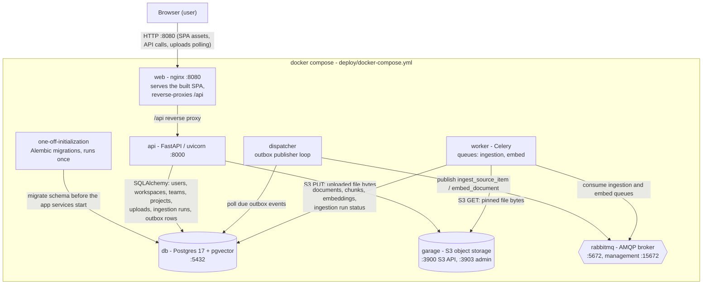
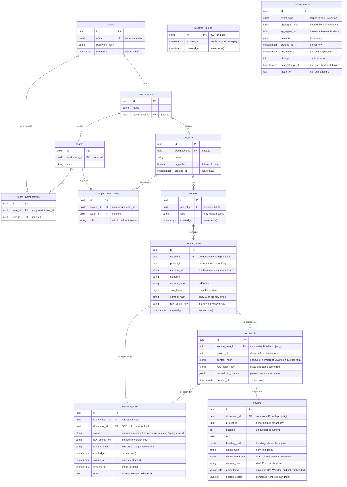

# System overview

Snapshot as of 2026-10-20, covering the service topology, the HTTP API, and the
database schema. Sources: `deploy/docker-compose.yml`, `backend/app/main.py`
and the five routers it mounts, `web/nginx.conf`, `web/src/app/api.ts`, the
RTK Query feature APIs plus `web/src/features/uploads/useProjectUploads.ts`,
and the ORM models in `backend/app`.

## Service topology

### Services

#### db

Postgres 17 with the pgvector extension. It holds every domain table - identity,
projects, the sources and ingestion tree, and the outbox queue - and the chunks
table carries the vector and full-text indexes that retrieval queries.

#### garage

S3-compatible object storage (single-node dev mode, bucket `rag-dev`) holding the
raw uploaded bytes under `raw/{project_id}/{source_item_id}/{content_hash}/{filename}`
keys. The api PUTs bytes on upload; the worker GETs them on ingest and verifies
them against the pinned hash.

#### rabbitmq

The AMQP broker moving task messages from the dispatcher to the worker. Both
queues are durable so a broker restart cannot drop a queued message, and there
is no result backend - task outcomes live in Postgres on the ingestion runs.

#### one-off-initialization

A one-shot container that runs the Alembic migrations and exits. The api,
worker, and dispatcher wait for its successful completion before booting, so the
schema always exists before the app tier starts.

#### api

The FastAPI app under uvicorn, serving every HTTP route in this document. On
upload it PUTs the bytes into Garage and records the domain rows plus an outbox
event in Postgres; it never publishes to RabbitMQ itself - that is the
dispatcher's job (transactional outbox).

#### worker

The Celery worker consuming the `ingestion` and `embed` queues (concurrency 2).
Its tasks are thin wrappers over the ingestion services: fetch the pinned bytes
from Garage, parse, chunk, and embed them (stub providers today), then write
documents, chunks, embeddings, and run status to Postgres. Late acks re-deliver
a task whose worker died mid-run.

#### dispatcher

A standalone polling process (deliberately not Celery Beat) that scans the
outbox table for due unpublished events and publishes them to RabbitMQ through
the routing map in `app/outbox/events.py`, waiting for broker confirms. A
failed row is backed off one exponential interval so poison events cannot
starve the rows behind them.

#### web

Nginx serving the built SPA from the `rag-web` image. It reverse-proxies `/api`
to the api service so the browser path is same-origin (no CORS involved), falls
back to `index.html` for SPA routes, and allows request bodies up to 26 MB so
the 25 MB upload limit fits.

Runtime flow of one upload:

1. The UI POSTs the file to `/api/projects/{project_id}/uploads`. The API PUTs the
   bytes into Garage and records the upload, a queued ingestion run, and an outbox
   event in Postgres.
2. The dispatcher polls the outbox table and publishes due events to RabbitMQ
   (`ingestion` queue, then `embed`).
3. The Celery worker consumes the tasks, fetches the bytes from Garage, parses and
   chunks them (stub provider today), embeds the chunks, and writes documents,
   chunks, embeddings, and the run status to Postgres.
4. The UI polls the uploads list every 2s until every row is terminal, which is how
   pipeline progress reaches the page.

Notes:

- The four app services (one-off-initialization, api, worker, dispatcher) share one
  backend image (`rag-backend`); the web UI is a separate nginx image (`rag-web`).
- The compose path is same-origin: nginx proxies `/api` to the api service, so no CORS
  is involved. The CORS middleware in `app/main.py` only matters for the ad-hoc Vite
  dev server (`VITE_API_BASE_URL`), which is not the runbook path.
- The AI provider layer lives behind replaceable interfaces: `app/providers` ships a
  stub parser and a stub embedding provider, and `llm_provider` defaults to the stub
  LLM, so the whole stack (including grounded answers) runs offline. Setting
  `RAG_LLM_PROVIDER=groq` and `RAG_GROQ_API_KEY` opts answers into Groq's
  `openai/gpt-oss-20b` - the first external AI service.

## API routes

All routes are served under the `/api` prefix (`app.include_router(..., prefix="/api")`).

### Health (backend/app/main.py)

| Method | Route | Purpose | UI usage |
| --- | --- | --- | --- |
| GET | `/api/health` | Liveness probe | Not called by the UI; used by the compose healthcheck |

### Identity (backend/app/identity/router.py)

| Method | Route | Purpose | UI usage |
| --- | --- | --- | --- |
| POST | `/api/auth/register` | Register an account with default workspace/team/project, returns a bearer token | RegisterPage (`authSlice`) |
| POST | `/api/auth/login` | Verify credentials, returns a bearer token | LoginPage (`authSlice`) |
| POST | `/api/auth/logout` | Revoke the presented bearer token | UserMenu (`authSlice`) |
| GET | `/api/users/me` | Id and email of the authenticated user | Session restore (`authSlice`) |
| GET | `/api/workspaces` | Workspaces reachable through the user's team memberships | CreateProjectDialog |
| GET | `/api/workspaces/{workspace_id}/teams` | The user's teams inside one workspace | CreateProjectDialog |

### Projects (backend/app/projects/router.py)

| Method | Route | Purpose | UI usage |
| --- | --- | --- | --- |
| POST | `/api/projects` | Create a project for a team | CreateProjectDialog |
| GET | `/api/projects` | Projects shared with any of the user's teams | ProjectsPage |
| GET | `/api/projects/public` | Every public project | Not called by the UI |
| GET | `/api/projects/{project_id}` | One project visible to the user | ProjectPage |
| PATCH | `/api/projects/{project_id}` | Update a project (team admin) | Not called by the UI |
| DELETE | `/api/projects/{project_id}` | Delete a project (team admin) | Not called by the UI |

### Uploads (backend/app/sources/router.py)

| Method | Route | Purpose | UI usage |
| --- | --- | --- | --- |
| POST | `/api/projects/{project_id}/uploads` | Store one uploaded file (PDF/DOCX, size-gated), queues an ingestion run | UploadCard |
| GET | `/api/projects/{project_id}/uploads` (polled by the UI: every 2s while any upload row is non-terminal; stops when all rows are terminal or an uncached fetch fails) | List a project's uploads newest first, status derived from the latest run | ProjectPage uploads table (`useProjectUploads`) |

The polling lives in `web/src/features/uploads/useProjectUploads.ts`: the
`getUploads` RTK Query hook runs with `pollingInterval: 2000` while any cached row
is still queued, fetching, processing, or indexing, and `pollingInterval: 0` once
every row is ready or failed. No other endpoint is polled - the other list endpoints
are fetched on mount and on RTK cache invalidation only, and no refetch-on-focus or
refetch-on-reconnect is configured.

### Answers (backend/app/answers/router.py)

| Method | Route | Purpose | UI usage |
| --- | --- | --- | --- |
| POST | `/api/projects/{project_id}/answer` | Ask one question: run the retrieval internally, then answer grounded in the final chunks (LLM provider layer: stub by default, Groq opt-in) | ProjectPage Ask tab (`ChatPanel`) |

Every retrieval call writes a `query_logs` row; its `params.origin` records the
calling surface - `direct` for the retrieval endpoint, `answer` for the answer
endpoint's internal call.

### Framework endpoints

| Method | Route | Purpose |
| --- | --- | --- |
| GET | `/api/docs` | Swagger UI |
| GET | `/api/docs/oauth2-redirect` | Swagger UI OAuth2 redirect |
| GET | `/api/redoc` | ReDoc |
| GET | `/api/openapi.json` | OpenAPI schema |

## Database tables

The ORM models in `backend/app` (`identity`, `projects`, `sources`, `ingestion`,
`outbox`) are the source of truth; the Alembic migrations under
`backend/alembic/versions/` create them exactly (0001-0002: identity and
projects, 0005: sources, ingestion, outbox).

### Entity relationship diagram

### Table explanations

#### users

A registered account. `email` is a Postgres `citext` column (case-insensitive and
unique) and `password_hash` is the only stored credential. Everything else hangs
off it: owned workspaces, team memberships, and thereby every project the user
can see.

#### workspaces

The tenant: a container for teams and projects, owned by exactly one user
(`owner_user_id`). Created automatically for every new account at registration.

#### teams

A group of users inside one workspace. A team is the unit that receives project
roles, so membership drives both visibility and permissions.

#### team_memberships

The join table between users and teams, one row per (team, user) pair, unique
together (`team_id` + `user_id`). Listing these is how the API answers "which
workspaces and teams does this user reach".

#### revoked_tokens

Logout support: each row stores one revoked JWT ID (`jti`, the primary key) and
the token's natural expiry, after which the row is pointless. Token
verification treats a listed `jti` as invalid.

#### projects

The unit of work: created by a team inside a workspace. `is_public` opens the
project to every signed-in user; otherwise only teams with a role row on it can
see it. Deleting a project cascades through sources, items, documents, and
chunks.

#### project_team_roles

One team's role on one project: `admin`, `editor`, or `viewer` (check
constraint), unique per (project, team). This single row set decides who may
read, upload to, or manage a project.

#### sources

A project's content source. This slice only creates rows with `type = 'upload'`,
and a partial unique index enforces one upload source per project, created
lazily by the first upload. Future source types (URLs, connectors) would add
values to the `type` check constraint.

#### source_items

One content item inside the upload source: for uploads, `external_id` is the
sanitized filename, unique per source, so a filename identifies the item. The
file fields (`filename`, `content_type`, `size_bytes`, `content_hash`,
`raw_object_key`) describe the latest accepted version; `raw_object_key` points
at the bytes in Garage and `content_hash` is their sha256. `project_id` is
deliberately denormalized and guarded by a composite foreign key
(`source_id` + `project_id` must match the parent source row) so Postgres itself
rejects cross-project rows.

#### documents

One normalized parse of a source item's content version, deduplicated by
`content_hash` (sha256 of the canonical normalized JSON, unique per item).
`normalized_content` holds the parsed structure; `raw_object_key` records which
stored bytes this parse came from. Carries the same denormalized `project_id`
with its own composite foreign key.

#### chunks

A retrieval-sized piece of one document, ordered by `position` (unique per
document). `text` is full-text searchable through the computed `search_vector`
tsvector (GIN index) even before embeddings exist; `embedding` is a pgvector
column (384 dims today, the stub provider's dimension) with an HNSW cosine
index and stays null until the embed task runs. `heading_path` and
`chunk_metadata` (the SQL column is named `metadata`) preserve context for
retrieval. Same denormalized `project_id` pattern as its parents.

#### ingestion_runs

The only place pipeline status lives: one row per ingestion attempt of a source
item. A run pins the file version it was created for (`raw_object_key` +
`content_hash`), so a re-upload can never redirect a queued run - the worker
refetches by the pinned key and verifies the fetched bytes against the pinned
hash. `status` is checked against the fixed vocabulary (queued, fetching,
processing, indexing, ready, failed) and `finished_at` is required to be non-null
exactly when the status is terminal. `document_id` points at the document the
run indexed and becomes null if a re-upload replaces it (SET NULL keeps the
history). The uploads listing derives each row's status from its latest run.

#### outbox_events

The transactional outbox: domain events (ingestion requested, document ready)
committed in the same transaction as the state change, then published at least
once by the dispatcher. `event_type` routes to a Celery task via
`app/outbox/events.py`; `payload` holds the task kwargs; `next_attempt_at` is
the due gate that backs failed rows off so poison events cannot starve later
ones; `published_at` marks rows the poller no longer scans.

### Conventions

- **Timestamps** are `timestamptz` (migration 0003 migrated the early tables),
  server-default `now()` for creation columns.
- **Tenant key**: `project_id` is repeated down the chain
  `sources -> source_items -> documents -> chunks` so retrieval filters chunks
  by project without joins, and composite foreign keys make Postgres enforce
  the boundary instead of relying on writers.
- **Deletion**: projects cascade to sources and their trees; `ingestion_runs`
  cascade with their item but keep their history via `documents.document_id`
  SET NULL on re-upload.
- **Indexes**: foreign keys are indexed explicitly (Postgres does not index them
  automatically; migration 0004), plus an HNSW index on `chunks.embedding` and
  a GIN index on `chunks.search_vector` for the two retrieval paths.
- `alembic_version` also exists in the database: one framework-managed row with
  the current migration revision, not an ORM model.
