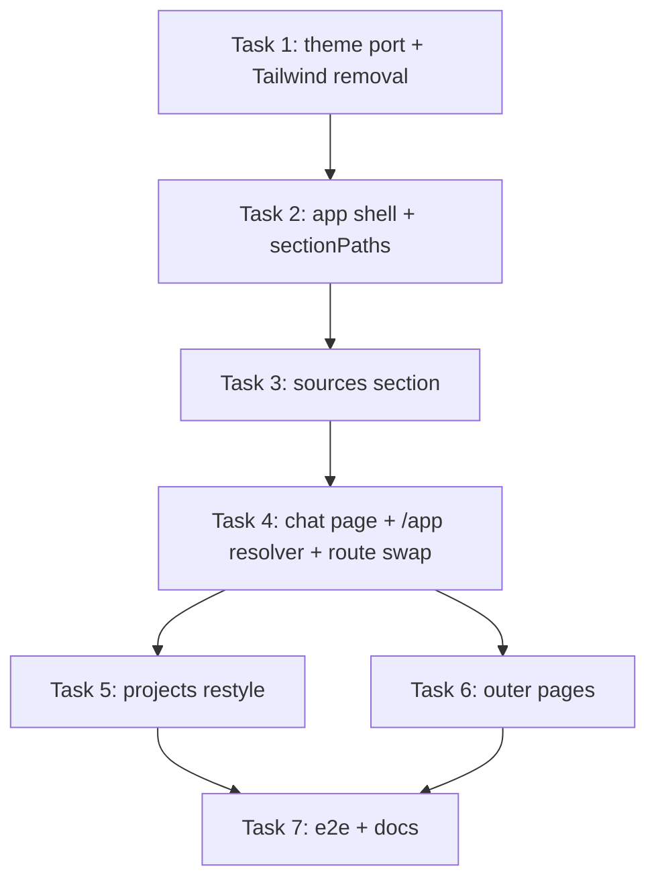

# UI Overhaul on the Official MUI Templates - Implementation Plan

> **For agentic workers:** REQUIRED SUB-SKILL: Use superpowers:subagent-driven-development (recommended) or superpowers:executing-plans to implement this plan task-by-task. Steps use checkbox (`- [ ]`) syntax for tracking.

**Goal:** Rebuild the web UI on the free official MUI templates (shared-theme, Dashboard shell, CRUD list styling, Marketing/Sign-in/Sign-up outer pages) so the old theme, layouts, and styling infrastructure are fully gone.

**Architecture:** One shared `AppTheme` (CSS variables, light/dark) replaces the old theme and the unused Tailwind wiring; a new `AppShell` (permanent sidebar + topbar) frames project-scoped section routes (`/projects/:id/sources`, `.../chat`) - there are no bare `/sources` or `/chat` routes, and the project dropdown always mirrors the URL; an internal `/app` resolver lands signed-in users on the latest chattable project's chat, else the latest project's sources, else `/projects`.

**Tech Stack:** React 19, MUI v9.5 (`@mui/material` + new `@mui/icons-material`), react-router 8, RTK Query, Vite, Vitest + Testing Library + MSW, Playwright.

**Spec:** `docs/superpowers/specs/2026-10-21-ui-mui-templates-design.md` (read it first; this plan argues from it. Amended 2026-10-21 after a fresh-context review and two user rulings: URL-synced sidebar/dropdown with no bare section routes, and Tailwind removal.)

## Global Constraints

- Template port sources are pinned: `https://raw.githubusercontent.com/mui/material-ui/v9.5.0/docs/data/material/getting-started/templates/<dir>/<file>` - port the `.tsx` variants; `shared-theme/customizations/surfaces.ts` is the lone `.ts` file.
- Dependencies: add ONLY `@mui/icons-material@^9`. Remove `@fontsource/work-sans`, `tailwindcss`, and `@tailwindcss/vite`. Do NOT add `@mui/x-charts`, `@mui/x-data-grid`, `@mui/x-date-pickers`, `@mui/x-tree-view`, or `dayjs`. `@fontsource/inter` stays.
- No backend, API, or `web/src/test/handlers.ts` baseline changes. Tests override endpoints with `server.use(...)` only.
- UI copy rules (spec sections 8-10): the in-app product UI says "sources"/"files", never "documents", for source-item surfaces; disabled future items use the exact chip label "Coming soon"; the "Add source" button reads exactly that; the projects toolbar button keeps the existing label "Create project" (renaming it would break `CreateProjectDialog.test.tsx` and the e2e journey for no product reason); sign out stays "Sign out". The landing hero copy ("Your documents, searchable by meaning") and `EmptyProjects` CTA are deliberate marketing-voice exceptions.
- jsdom never matches media-feature queries (its `evaluateMediaList` returns false for them), so responsive `sx` values like `display: { xs: "none", md: "block" }` resolve to the xs value and the element is CSS-hidden in tests - role queries then skip it entirely. Consequences: test `NavMenuContent` and `ProjectSelect` directly (they carry no responsive hiding), reach shell-level md+-only pieces with `{ hidden: true }` queries, and render ONE CTA set plus ONE mode switcher in the marketing/auth frames instead of the template's desktop/mobile duplicates. Note the inverse: xs-only pieces (the mobile hamburger) are the visible ones in jsdom.
- Comments start with a capital letter and end with a dot; explain why, not what. No em dashes anywhere.
- `web/tsconfig.app.json` sets `verbatimModuleSyntax: true`: type-only imports must use `import type`, and every task runs `npx tsc -b` because neither lint nor vitest type-checks.
- Verification per task, in `web/`: `npx vitest run <focused files>`, `npm run lint`, `npx tsc -b`, and `npm run format:check` (the upstream template files use single quotes; format every port within its own task, never later), then the full `npm test` before the task's final commit. Task 7 additionally runs `npm run build` and `npm run e2e`.
- One concern per commit; commit messages follow the repo's `type(scope): summary` style seen in `git log`.
- Known vitest flakiness under parallel load (backlog `docs/backlog.md`, "Todo later", 2026-10-12 entry): userEvent typing tests and the `App.test.tsx` root-redirect test can time out when several suites saturate jsdom workers; the worktree baseline also flaked once on `ProjectPage.test.tsx`'s polling-timing test (green in isolation, and that file is deleted in Task 4). Re-run the single file before treating a failure as real.

## Review Focus

Failure classes the spec implies but per-task tests might miss - each is pinned by the named test:

1. A project's uploads fetch fails (500) while the `/app` resolver scans - the resolver treats it as "not chattable", continues the walk, and still lands somewhere (the other chattable project's chat, or latest sources), never hangs. Pinned in Task 4, `ChatLanding` "treats a failing uploads fetch as not chattable".
2. Changing the project while deep in a section (`/sources/upload`) keeps the deep section, not just the section root. Pinned in Task 2, `ProjectSelect` "keeps the deep section when swapping projects".
3. Drag-and-drop with an empty or zero-file drop does nothing (no upload, no error alert). Pinned in Task 3, `UploadDropzone` "ignores an empty drop".
4. A same-name re-upload (server 409) surfaces the server copy in the dropzone Alert - the mutation error path, not only client-side rejections. Pinned in Task 3, `UploadDropzone` "shows the server's 409 copy when the filename already exists", plus the journey e2e.
5. A deep link to a specific project's chat with nothing ready shows the empty state (no redirect away) and flips live once polling marks a row ready. Pinned in Task 4, `ChatPage` "flips from empty state to the panel when an upload turns ready".

---

### Task 1: Theme port + dependency swap

**Files:**
- Create: `web/src/theme/AppTheme.tsx`, `web/src/theme/themePrimitives.ts`, `web/src/theme/ColorModeIconDropdown.tsx`, `web/src/theme/customizations/{inputs,navigation,dataDisplay,feedback}.tsx`, `web/src/theme/customizations/surfaces.ts`, `web/src/theme/AppTheme.test.tsx`
- Modify: `web/src/app/App.tsx`, `web/src/test/test-utils.tsx`, `web/src/theme/global.css`, `web/vite.config.ts`, `web/package.json`
- Delete: `web/src/theme/theme.ts`, `web/src/theme/theme.test.tsx`

**Interfaces:**
- Produces: `export default function AppTheme(props: { children: ReactNode; themeComponents?: ThemeOptions["components"] }): JSX.Element` (port of `shared-theme/AppTheme.tsx` minus the docs-only `disableCustomTheme` prop); `ColorModeIconDropdown` default export with its trigger carrying `aria-label="color mode"` and its menu id renamed from upstream "account-menu" to "color-mode-menu" (align the trigger's `aria-controls` with the renamed id); `themePrimitives.ts` exports `brand, gray, green, orange, red, colorSchemes, typography, shape, shadows` plus the `declare module` blocks (drop `getDesignTokens` - unused); each customization file exports its named `*Customizations` const exactly as upstream.

- [ ] **Step 1: Swap dependencies and remove the Tailwind wiring**

Run in `web/`: `npm install @mui/icons-material@^9`, then `npm uninstall @fontsource/work-sans tailwindcss @tailwindcss/vite`. Edit `web/src/theme/global.css` to import only `@fontsource/inter/400.css`, `/500.css`, and `/600.css` (600 is new - the template's heading weights need it). Remove the `tailwindcss()` plugin from `web/vite.config.ts`.

- [ ] **Step 2: Write the failing theme test**

Create `web/src/theme/AppTheme.test.tsx` with four tests around a probe component that reads `useTheme()`:

```tsx
it("renders children under the template theme", ...); // probe asserts theme.palette.mode === "light"
it("applies the template typography and palette", ...); // fontFamily contains "Inter"; primary.main is the brand 400 string from themePrimitives
it("resolves the dark scheme", ...); // theme.colorSchemes.dark is defined with the dark background color
it("applies the ported component customizations", ...); // theme.components?.MuiMenuItem?.styleOverrides is defined (navigation customization)
```

- [ ] **Step 3: Run it to verify it fails**

Run: `npx vitest run src/theme/AppTheme.test.tsx`
Expected: FAIL (AppTheme.tsx does not exist).

- [ ] **Step 4: Port the shared theme**

Fetch and port from `.../templates/shared-theme/`: `AppTheme.tsx` (drop `disableCustomTheme`), `themePrimitives.ts` (drop `getDesignTokens`; note upstream's `interface PaletteColor extends ColorRange {}` may trip eslint's `no-empty-object-type` under `--max-warnings 0` - declaration merging requires the empty interface, so a justified disable comment on that line is the accepted fix), `customizations/inputs.tsx`, `customizations/navigation.tsx`, `customizations/dataDisplay.tsx`, `customizations/feedback.tsx`, `customizations/surfaces.ts`, and `ColorModeIconDropdown.tsx`. Adapt to repo rules: named imports per file, `import type` for type-only imports (`verbatimModuleSyntax`), the mode switcher's accessible name and menu id per the Interfaces block. Then edit `web/src/app/App.tsx`: remove the `createTheme`/`ThemeProvider`/`createAppTheme` imports and wrap with `<AppTheme>` (CssBaseline and BrowserRouter stay inside). Edit `web/src/test/test-utils.tsx` the same way. Delete `theme.ts` and `theme.test.tsx`.

- [ ] **Step 5: Run the suite, lint, type check, and format check**

Run: `npx vitest run src/theme/AppTheme.test.tsx` then full `npm test`, `npm run lint`, `npx tsc -b`, and `npm run format:check`.
Expected: all pass. Any test asserting old-theme specifics is updated to the new theme's facts (there should be none beyond the deleted `theme.test.tsx`).

- [ ] **Step 6: Commit**

```bash
git add -A
git commit -m "feat(web): replace the theme with the MUI shared-theme port"
```

### Task 2: App shell - sectionPaths, sidebar, topbar, project select

**Files:**
- Create: `web/src/app/sectionPaths.ts` + `sectionPaths.test.ts`, `web/src/layouts/navItems.tsx`, `web/src/layouts/NavMenuContent.tsx` + `NavMenuContent.test.tsx`, `web/src/layouts/SideNav.tsx`, `web/src/layouts/SideNavMobile.tsx` + `SideNavMobile.test.tsx`, `web/src/layouts/ProjectSelect.tsx`, `web/src/layouts/AppShell.tsx`, `web/src/layouts/AppShell.test.tsx`, `web/src/layouts/ProjectSelect.test.tsx`
- Modify: `web/src/features/auth/UserMenu.tsx` + `UserMenu.test.tsx`, `web/src/app/AppRoutes.tsx`, `web/src/app/App.test.tsx`, `web/src/features/projects/ProjectsPage.tsx`, `web/src/features/projects/ProjectPage.tsx`
- Delete: `web/src/layouts/DashboardLayout.tsx`, `web/src/layouts/DashboardLayout.test.tsx`

**Interfaces:**
- Consumes: `AppTheme`, `ColorModeIconDropdown` (Task 1); `UserMenu` default export (modified in place); `Project` type (`features/projects/projectsApi.ts`).
- Produces: `web/src/app/sectionPaths.ts` exporting pure functions - `projectIdFromPath(pathname: string): string | null`; `sectionPath(section: "sources" | "chat", projectId: string): string` (returning `/projects/:id/sources` and `/projects/:id/chat`); `switchProjectPath(pathname: string, newProjectId: string): string` (swaps the `/projects/:id` segment and keeps everything after it, so `/projects/p-1/sources/upload` becomes `/projects/p-2/sources/upload` - this is what preserves deep paths on a project swap); and `activeSection(pathname: string): "projects" | "sources" | "chat" | null` (Projects active only on exactly `/projects`; Sources on `/projects/:id/sources` and below; Chat on `/projects/:id/chat`). Also: `NAV_ITEMS` static metadata (label, icon, section key; Users/Analytics carry `comingSoon`); `NavMenuContent` default export (the nav list; the active `ListItemButton` carries `aria-current="page"` so tests can query it); `AppShell` default export rendering `<Outlet/>`; `ProjectSelect` self-contained default export (carries `aria-label="Project"`, and shows the "Select project" placeholder not only on `/projects` but also while the URL's project id is not in the loaded list - loading or a stale id - which avoids MUI's out-of-range Select warning); `SideNavMobile({ open, onClose })`.

- [ ] **Step 1: Write failing tests**

- `sectionPaths.test.ts` (pure): `projectIdFromPath` extracts the id from `/projects/p-1/sources`, `/projects/p-1/sources/upload`, `/projects/p-1/chat`, and returns `null` for `/projects` and `/`; `switchProjectPath("/projects/p-1/sources/upload", "p-2")` is `/projects/p-2/sources/upload` and `switchProjectPath("/projects/p-1/sources", "p-2")` is `/projects/p-2/sources`; `activeSection("/projects")` is `"projects"` while `activeSection("/projects/p-1/sources/upload")` is `"sources"` and `activeSection("/projects/p-1/chat")` is `"chat"` - never two sections at once.
- `NavMenuContent.test.tsx` (render the nav list DIRECTLY - it carries no responsive hiding, so role queries see it in jsdom; MSW: projects `[p-1 "Default" 10:00, p-2 "Research" 11:00]` - deliberately oldest-first in the response so the newest-first sort is actually exercised): all five labels render; Users and Analytics carry `aria-disabled="true"` (MUI disabled list items expose `aria-disabled`, not the `disabled` attribute) and both "Coming soon" chips are visible; at `/projects/p-1/sources` the Sources item carries `aria-current="page"` and Projects does not; at `/projects/p-2/sources/upload` only Sources is active; at `/projects` the Sources and Chat items link to `/projects/p-2/sources` and `/projects/p-2/chat` (latest project); with `[]` the Sources and Chat items are disabled.
- `AppShell.test.tsx` (preload a signed-in auth state - `UserMenu` renders nothing without a user; MSW: projects `[p-1 "Default" 10:00, p-2 "Research" 11:00]`): render the shell at `/projects/p-1/sources` via a stub route; the permanent drawer is CSS-hidden in jsdom (Global Constraints), so reach its items with `{ hidden: true }` role queries and assert one nav label plus the topbar pieces: the mobile hamburger (visible in jsdom - its xs value is the shown one), `ProjectSelect` (by its "Project" label), the mode switcher (by accessible name), and the account avatar button.
- `SideNavMobile.test.tsx`: rendered with `open`, it shows the nav items and clicking one calls `onClose` and navigates.
- `ProjectSelect.test.tsx` (MSW: projects `[p-1 "Default" 10:00, p-2 "Research" 11:00]` - oldest-first response, so the sort is exercised): at `/projects/p-1/sources` the select's value is "Default"; opening it lists "Research" before "Default" (newest first); selecting "Research" there navigates to `/projects/p-2/sources`; "keeps the deep section when swapping projects" - selecting "Research" at `/projects/p-1/sources/upload` navigates to `/projects/p-2/sources/upload` (Review Focus #2); at `/projects` (no project) the select shows the "Select project" placeholder and selecting "Research" navigates to `/projects/p-2/sources`; with `GET */api/projects` -> `[]` the select is disabled showing "No projects" (assert `aria-disabled`); with projects `[p-2]` only at `/projects/p-9/sources` the placeholder shows (stale id - no out-of-range value).
- `UserMenu.test.tsx`: add - the menu shows a disabled "Settings" entry (assert `aria-disabled` or the "Coming soon" chip) above "Sign out".

- [ ] **Step 2: Run them to verify they fail**

Run: `npx vitest run src/app/sectionPaths.test.ts src/layouts`
Expected: FAIL (files do not exist).

- [ ] **Step 3: Implement the shell**

Create `sectionPaths.ts` first (pure; one source of truth for hrefs, project swaps, and active state). Port references: `.../templates/dashboard/components/{SideMenu,SideMenuMobile,MenuButton,MenuContent,SelectContent}.tsx` and the `Dashboard.tsx` composition. Build `navItems.tsx` (static metadata: Projects `FolderRounded`, Sources `UploadFileRounded`, Chat `ChatBubbleRounded`, Users `GroupRounded` + Analytics `InsightsRounded` with `comingSoon`), `NavMenuContent.tsx` (List of `ListItemButton`s; hrefs from `sectionPaths` + `useLocation`, falling back to the latest project from `useGetProjectsQuery` when no project is in the URL, disabled when there are no projects; the active item carries `aria-current="page"`; `comingSoon` items disabled with a small "Coming soon" `Chip`), `SideNav.tsx` (permanent `Drawer`, wordmark "RAG" on top), `SideNavMobile.tsx` (temporary `Drawer`, props `{ open, onClose }`), `ProjectSelect.tsx` (Select styled after `SelectContent`; sorts projects by `created_at` descending; value always mirrors the URL - the URL's project when the id is in the loaded list, an empty "Select project" placeholder otherwise, disabled "No projects" when the list is empty; `onChange` navigates to `switchProjectPath(pathname, newId)` when the URL carries a project - preserving any deep path - else to `/projects/:id/sources`), and `AppShell.tsx` (fixed `AppBar`: `MenuButton` hamburger hidden on `md`+ toggling `SideNavMobile`, `ProjectSelect`, spacer, `ColorModeIconDropdown`, `UserMenu`; permanent `SideNav`; main `Box` with `Toolbar` spacer and a `Container maxWidth="lg"` holding `<Outlet/>`; no footer). Update `UserMenu.tsx`: insert a disabled "Settings" `MenuItem` with a "Coming soon" `Chip` between the email subheader and "Sign out"; keep the sign-out logic and its comments byte-for-byte. Rewire `AppRoutes.tsx`: a pathless guarded layout route `<Route element={<RequireAuth><AppShell/></RequireAuth>}>` nesting the existing `/projects` and `/projects/:projectId` pages; landing/about/login/register and the `*` fallback stay outside. Interim note (resolved by Tasks 3-4): the sidebar's Sources/Chat hrefs point at routes that do not exist yet, so until then those clicks bounce through the `*` catch-all back to `/projects` - acceptable for two tasks, do not add placeholder routes. Remove the `DashboardLayout` wrapper from `ProjectsPage`/`ProjectPage` and delete `DashboardLayout.tsx` + its test. Update `App.test.tsx` line 52's `findByText("Projects")` to `findByRole("heading", { name: "Projects" })` - the sidebar now renders a second "Projects" text and `findByText` would throw on the duplicate.

- [ ] **Step 4: Run the suite, lint, type check, and format check**

Run: `npx vitest run src/app/sectionPaths.test.ts src/layouts` then full `npm test`, `npm run lint`, `npx tsc -b`, and `npm run format:check`.
Expected: all pass.

- [ ] **Step 5: Commit**

```bash
git add -A
git commit -m "feat(web): add the MUI dashboard shell with URL-synced project selection"
```

### Task 3: Sources section - index, add-source menu, file-upload page

**Files:**
- Create: `web/src/features/projects/useProjectGuard.ts`, `web/src/features/sources/SourcesPage.tsx` + test, `web/src/features/sources/AddSourceMenu.tsx` + test, `web/src/features/sources/SourceItemsTable.tsx` + test, `web/src/features/sources/UploadDropzone.tsx` + test, `web/src/features/sources/FileUploadPage.tsx` + test
- Modify: `web/src/app/AppRoutes.tsx`

**Interfaces:**
- Consumes: `AppShell` routes (Task 2); `useProjectUploads(projectId, { skip })`, `useUploadFileMutation`, `uploadRejection`, `MAX_UPLOAD_MB`, `statusChip`, `Upload` (existing).
- Produces: `useProjectGuard(projectId: string | undefined): { project: Project | undefined; projectMissing: boolean; projectUncacheableError: boolean; projectLoading: boolean; refetch: () => void }` - the shared project-scope guard owning loading, the 404 state ("Project not found." + back-to-projects link), and the retryable "Could not load project." state (logic ported from `ProjectPage.tsx`'s private `errorStatus` helper, which dies with that file); `SourcesPage()`; `AddSourceMenu({ projectId })`; `SourceItemsTable({ items: Upload[] })`; `UploadDropzone({ projectId })`; `FileUploadPage()`.

- [ ] **Step 1: Write failing tests**

Cover, with the baseline MSW fixtures (p-1 uploads: brief.pdf queued, report.docx ready, broken.pdf failed). This task also inherits the upload/polling coverage that dies with `ProjectPage.test.tsx` in Task 4 - port every one of these or the slice loses it:

- `AddSourceMenu.test.tsx`: the "Add source" button opens a menu listing "File upload", "Website", "Google Drive"; Website and Google Drive are disabled with a "Coming soon" chip each; clicking "File upload" navigates to `/projects/p-1/sources/upload`.
- `SourceItemsTable.test.tsx`: renders rows with filename, Type column "File upload" on every row, a status chip, and the filename linking to `/projects/p-1/sources/upload`; with zero items renders "No source items yet.".
- `UploadDropzone.test.tsx`, click path (ported from `ProjectPage.test.tsx` / `UploadCard` coverage): port the file's `beforeAll` realm swap first (`ProjectPage.test.tsx` lines 112-130 installs Node's `File`/`FormData` globals - without it multipart never round-trips through undici and every posting test fails); "uploads the chosen file as multipart form data with a file part"; "keeps Upload disabled while the request is pending" (queries a control named "Upload" - the dropzone must keep a button-named "Upload" control, and the "Click or drag files to upload" helper text must stay out of the input's accessible name); "renders the upload control with copy derived from the size limit" (ported from `UploadCard.test.tsx:30`); "rejects a file with an unsupported extension without posting"; "rejects a file over the 25MB limit without posting"; "rejects an empty file without posting"; "keeps the upload control a single tab stop"; "shows friendly copy when the server rejects the upload with 422"; "shows friendly copy when storage is unavailable (503)"; "shows the server's 409 copy when the filename already exists".
- `UploadDropzone.test.tsx`, drag path (new): a `fireEvent.drop` with two valid files posts both sequentially (assert two POSTs via an MSW counter); "stops the batch at the first failure" - drop `[valid, invalid, valid]` and assert only the first file is posted and the rejection alert shows; "ignores an empty drop" (`{ dataTransfer: { files: [] } }` - no POST, no alert). The hidden input keeps the accessible name "Upload" and carries the `multiple` attribute.
- `SourcesPage.test.tsx`: renders the toolbar (heading "Sources", search field, "Add source"), the three fixture rows; typing "report" in the search leaves only report.docx; the 404 case (override `GET */api/projects/p-1` -> 404) renders "Project not found." with the back-to-projects link; the retryable project-error case (override -> 500 with nothing cached) renders "Could not load project." with a working Try again (pins the shared `useProjectGuard` error branch).
- `FileUploadPage.test.tsx`: renders "Back to sources" linking to `/projects/p-1/sources`, heading "File upload", the dropzone, and the fixture rows; the 404 case renders "Project not found.".
- Polling coverage (ported from `ProjectPage.test.tsx`), split between the two page tests: `FileUploadPage.test.tsx` gets "polls while an upload is in flight and stops once all rows are terminal" and "shows a friendly error state and stops polling when the uploads list fails" (new copy: "Could not load the source items."); `SourcesPage.test.tsx` gets the same two against its own list.

- [ ] **Step 2: Run them to verify they fail**

Run: `npx vitest run src/features/sources`
Expected: FAIL (directory does not exist).

- [ ] **Step 3: Implement the sources feature**

Styling reference: `.../templates/crud-dashboard/components/EmployeeList.tsx` and `PageContainer.tsx` (toolbar + table-in-card look); behavior follows `ProjectsPage`/`ProjectPage` patterns (loading skeletons, retryable error card, empty state). Create `useProjectGuard` first (per the Interfaces block - the three project-scoped pages and Task 4's ChatPage share it, so the guard states cannot drift), then the five components per the Interfaces block: `AddSourceMenu` holds a `SOURCE_TYPES` const (`upload` -> navigates to `` `/projects/${projectId}/sources/upload` ``; website + gdrive disabled with "Coming soon"); `SourceItemsTable` columns: Filename (Link), Type ("File upload"), Status (`Chip` via `statusChip`), Created (`toLocaleDateString`); `UploadDropzone` ports `UploadCard`'s check/mutation/alert logic (keep the tabIndex/-1 hidden-input comment) and adds `onDrop`/`onDragOver` plus the `multiple` attribute - copy `Array.from(event.target.files ?? [])` (or the dropped list) BEFORE resetting the input's `value`, files upload strictly in order, and the first failure (client rejection or server error) stops the batch, with later files never sent. Add routes to `AppRoutes.tsx` inside the shell group: `/projects/:projectId/sources` -> `SourcesPage`, `/projects/:projectId/sources/upload` -> `FileUploadPage`. The old `/projects/:projectId` tab page stays until Task 4. There is deliberately no `/sources` route and no `NoProjectsState` component (spec decision 2; zero-project flows land on `/projects`).

- [ ] **Step 4: Run the suite, lint, type check, and format check**

Run: `npx vitest run src/features/sources src/features/projects` then full `npm test`, `npm run lint`, `npx tsc -b`, and `npm run format:check`.
Expected: all pass.

- [ ] **Step 5: Commit**

```bash
git add -A
git commit -m "feat(web): add the sources section with the add-source menu and upload dropzone"
```

### Task 4: Chat page, /app landing resolver, route swap

**Files:**
- Create: `web/src/features/chat/ChatPage.tsx` + test, `web/src/features/chat/ChatLanding.tsx` + test, `web/src/features/projects/ProjectRedirect.tsx` + test
- Modify: `web/src/app/AppRoutes.tsx`, `web/src/features/landing/LandingPage.tsx` + `LandingPage.test.tsx`, `web/src/features/auth/LoginPage.tsx` + `LoginPage.test.tsx`, `web/src/features/auth/RegisterPage.tsx` + `RegisterPage.test.tsx`, `web/src/app/App.test.tsx`
- Delete: `web/src/features/projects/ProjectPage.tsx` + `ProjectPage.test.tsx`, `web/src/features/uploads/UploadCard.tsx` + `UploadCard.test.tsx`, `web/src/features/uploads/UploadsTable.tsx`

**Interfaces:**
- Consumes: `ChatPanel({ projectId })`, `useProjectUploads`, `useProjectGuard` (Task 3), `useGetProjectsQuery`, `uploadsApi.endpoints.getUploads`, `Project`/`Upload` types, `sectionPaths` (Task 2).
- Produces: `ChatPage()`; `ChatLanding()` mounted at the internal `/app` route; `ProjectRedirect()`; route `/projects/:projectId` now redirects to `.../sources`; the three signed-in `Navigate` destinations (`LandingPage`, `LoginPage`, `RegisterPage`) become `/app`. All resolver and redirect navigations are `replace` (`<Navigate replace>` / `navigate(target, { replace: true })`) - a push would trap the Back button on `/app`, which redirects forward again.

- [ ] **Step 1: Write failing tests**

- `ChatPage.test.tsx`: "renders the panel when a source item is ready" (baseline p-1 uploads include ready report.docx - the chat textarea renders); "shows a loading state, not the empty state, while the uploads load" (the empty state must not flash for a chattable project - assert a skeleton/progress placeholder until the list lands); "shows the retryable error state when the uploads list cannot load" (uncached 500 -> "Could not load the source items." + Try again, not the empty state); "shows the empty state until a source item is ready" (override p-1 uploads to all `queued` - renders "Upload sources to start asking questions." and a "Go to sources" link whose `href` is `/projects/p-1/sources`, an absolute project-scoped URL - `..`-relative links resolve through the route tree and a pathless layout makes them land on the banned `/sources`); "flips from empty state to the panel when an upload turns ready" (reuse `ProjectPage.test.tsx`'s fake-timer polling pattern: a queued row flips to ready on the next poll - this also covers polling continuing while the panel is showing); the 404 case renders "Project not found." (via the shared `useProjectGuard`).
- `ChatLanding.test.tsx` (all fixtures deliberately oldest-first in the response: `[p-1 "Default" 10:00, p-2 "Research" 11:00]`, so the newest-first sort is exercised): "redirects to the newest chattable project's chat" (p-1 ready, p-2 ready: final URL `/projects/p-2/chat`); "skips processing projects and lands on the older chattable one" (p-2 all `queued`, p-1 ready: URL `/projects/p-1/chat` - the main-case test); "falls back to the latest project's sources when none are chattable" (both queued: URL `/projects/p-2/sources`); "treats a failing uploads fetch as not chattable" covers both directions: p-2 uploads -> 500 with p-1 ready lands on `/projects/p-1/chat` (the walk continues past the failure), and p-2 -> 500 with p-1 all queued lands on `/projects/p-2/sources` (never hangs); "renders the projects list when there are no projects" (`[]` -> location `/projects`); "refetches stale cached statuses" (renderWithProviders builds a fresh store per call, so prime the cache within ONE render: a priming route renders a small component subscribing to `useGetUploadsQuery("p-1")`, wait for the queued row, `server.use(...)` the ready handler, then navigate to `/app` via a Link - the resolver's forced refetch must land on chat despite the cached `queued` statuses).
- `ProjectRedirect.test.tsx`: at `/projects/p-1` the location becomes `/projects/p-1/sources`.
- Update the three funnel tests: `LandingPage.test.tsx` "redirects authenticated visitors" - add a `/app` -> `ChatLanding` route to its router; with the baseline `[]` projects the resolver lands on `/projects`, but the resolver now needs MSW round-trips, so the test becomes `async` and its assertions become `findBy*`. `LoginPage.test.tsx` (lines ~65, ~109, and the synchronous line ~122) and `RegisterPage.test.tsx` (lines ~101, ~159, and the synchronous line ~172) currently assert "Projects" text after the redirect with routers that only define `/projects` - add `/app` -> `ChatLanding` and `/projects/:projectId/chat` -> `ChatPage` routes to their routers, override `GET */api/projects` -> `[p-1]` (baseline p-1 is chattable via ready report.docx), make them `async`, and assert the funnel lands on `/projects/p-1/chat` (the chat input or the location) with `findBy*`.
- Update `App.test.tsx`: "renders the project page for an authenticated visitor" (navigates to `/projects/p-1`) now follows `ProjectRedirect` - assert the sources page instead (heading "Sources", the brief.pdf row, `window.location.pathname === "/projects/p-1/sources"`; the "Back to sources" breadcrumb lives on the file-upload page, not the sources index, so do not assert it here). The "redirects a token holder from /" test keeps passing unchanged: with the baseline `[]` projects, `/app` resolves to `/projects`.

- [ ] **Step 2: Run them to verify they fail**

Run: `npx vitest run src/features/chat src/features/projects/ProjectRedirect.test.tsx`
Expected: FAIL (files do not exist).

- [ ] **Step 3: Implement the chat landing**

`ChatPage`: `useParams` -> the shared `useProjectGuard` (loading, 404, retryable error states) + `useProjectUploads(projectId, { skip: projectMissing })`; render a loading placeholder while the uploads list is still loading, the retryable "Could not load the source items." card on an uncached fetch error, otherwise `hasReady = (uploads ?? []).some((u) => u.status === "ready")` drives the split: `ChatPanel` when `hasReady`, else the empty state (`ChatBubbleRounded` icon, copy, "Go to sources" `Button component={RouterLink}` to `` `/projects/${projectId}/sources` ``). `ChatLanding` (mounted at `/app`): fetch projects, sort newest-first, then a **sequential** walk - for each project in order, dispatch `uploadsApi.endpoints.getUploads.initiate(projectId, { forceRefetch: true })`, await the result (a fetch error counts as not chattable), and stop at the first project with a `ready` item; `Navigate` to its `/chat` with `replace`; if the walk finishes with none chattable, `Navigate` (replace) to the newest project's `/sources`; with `[]` projects, `Navigate` (replace) to `/projects`; with an uncached projects error, render the retryable card ("Could not load projects." + Try again); while the walk is pending render a light centered `CircularProgress` inside the shell (not `BootSplash`, which assumes a full viewport); unsubscribe the `initiate` handles on cleanup. Guard the effect against re-entry with a cancelled flag. Add routes: `/app` -> `ChatLanding`, `/projects/:projectId` -> `ProjectRedirect`, `/projects/:projectId/chat` -> `ChatPage`, all inside the guarded shell group. Change the three signed-in `Navigate to="/projects"` redirects to `/app` (they already carry `replace`), and update `LandingPage`'s mid-sign-out comment that names the `/projects` landing so it names `/app`. Delete `ProjectPage.tsx` + test, `UploadCard.tsx` + test, and `UploadsTable.tsx` (their replacements landed in Tasks 2-3; the coverage they held was ported in Task 3).

- [ ] **Step 4: Run the suite, lint, type check, and format check**

Run: `npx vitest run src/features/chat src/features/projects src/features/landing src/features/auth src/app` then full `npm test`, `npm run lint`, `npx tsc -b`, and `npm run format:check`.
Expected: all pass.

- [ ] **Step 5: Commit (two concerns, two commits; the second is deletions only)**

```bash
git add web/src/features/chat web/src/features/projects/ProjectRedirect.tsx web/src/features/projects/ProjectRedirect.test.tsx web/src/app web/src/features/landing/LandingPage.tsx web/src/features/landing/LandingPage.test.tsx web/src/features/auth
git commit -m "feat(web): add the chat page and the /app latest-chattable-project resolver"
git add -A
git commit -m "refactor(web): retire the project tab page in favor of the section pages"
```

### Task 5: Projects page restyle

**Files:**
- Modify: `web/src/features/projects/ProjectsPage.tsx` + `ProjectsPage.test.tsx`

**Interfaces:**
- Consumes: existing `useGetProjectsQuery`, `CreateProjectDialog`, `EmptyProjects`, snackbar/error patterns; `sectionPath` (Task 2).
- Produces: no interface change - same default export, restyled; row name links now go to the project's sources page (the route swap in Task 4 makes that the natural target, so this task lands after it).

- [ ] **Step 1: Write the failing search test**

Add to `ProjectsPage.test.tsx`: "filters rows by the search field" - MSW returns `[p-1 "Alpha", p-2 "Beta"]`; typing "alp" leaves Alpha's row and removes Beta's; clearing the field restores both. Also update the existing "links project names to their project pages" test (line 45): its href assertions (`/projects/p-2`, `/projects/p-1`) become `/projects/p-2/sources` and `/projects/p-1/sources`.

- [ ] **Step 2: Run it to verify it fails**

Run: `npx vitest run src/features/projects/ProjectsPage.test.tsx`
Expected: FAIL (no search field exists; the link test still expects the old hrefs).

- [ ] **Step 3: Restyle the page**

Toolbar per the CRUD template look: heading "Projects" with a `TextField` (label "Search projects", `size="small"`) and the "Create project" contained button on the right - keep that exact label, `CreateProjectDialog.test.tsx` and the e2e journey click it; client-side case-insensitive name filter; wrap the table in the template's rounded outlined `Card` (matching `SourceItemsTable`); keep the skeleton rows, `EmptyProjects`, error card, and snackbar logic unchanged; row name links to `sectionPath("sources", project.id)`.

- [ ] **Step 4: Run the suite, lint, type check, and format check**

Run: `npx vitest run src/features/projects` then full `npm test`, `npm run lint`, `npx tsc -b`, and `npm run format:check`.
Expected: all pass.

- [ ] **Step 5: Commit**

```bash
git add -A
git commit -m "feat(web): restyle the projects list with search and the CRUD toolbar"
```

### Task 6: Outer pages on the official templates

**Files:**
- Create: `web/src/layouts/MarketingFrame.tsx` + test, `web/src/layouts/AuthFrame.tsx` + test
- Modify: `web/src/features/landing/LandingPage.tsx` + `LandingPage.test.tsx`, `web/src/features/about/AboutPage.tsx` + `AboutPage.test.tsx`, `web/src/features/auth/LoginPage.tsx` + `LoginPage.test.tsx`, `web/src/features/auth/RegisterPage.tsx` + `RegisterPage.test.tsx`
- Delete: `web/src/layouts/MarketingLayout.tsx` + test, `web/src/layouts/AuthLayout.tsx` + test, `web/src/layouts/SiteFooter.tsx` + test

**Interfaces:**
- Consumes: `ColorModeIconDropdown` (Task 1); the pages' existing auth logic and copy.
- Produces: `MarketingFrame({ children })` (marketing navbar + footer), `AuthFrame({ children })` (centered sign-in frame); no other exports.

- [ ] **Step 1: Write failing frame tests**

`MarketingFrame.test.tsx`: renders the wordmark "RAG" linking to `/`, an "About" link, the mode switcher (by accessible name), "Sign in" linking `/login`, "Get started" linking `/register`, children, and the footer copyright. `AuthFrame.test.tsx`: renders the wordmark, the mode switcher, and children inside a card.

- [ ] **Step 2: Run them to verify they fail**

Run: `npx vitest run src/layouts/MarketingFrame.test.tsx src/layouts/AuthFrame.test.tsx`
Expected: FAIL (files do not exist).

- [ ] **Step 3: Build the frames and rebuild the pages**

Port references: `.../templates/marketing-page/components/{AppAppBar,Hero,Features,Footer}.tsx` (skip Pricing/Testimonials/FAQ/Highlights/LogoCollection - no content for them, spec section 10), `.../templates/sign-in/SignIn.tsx` and `.../templates/sign-up/SignUp.tsx` (take the layout shells only - our forms have no social buttons or forgot-password). Create `MarketingFrame.tsx` (AppAppBar structure simplified for our needs: "RAG" wordmark, "About" link, `ColorModeIconDropdown`, Sign in / Get started buttons - render ONE CTA set and ONE mode switcher, not the template's desktop/mobile duplicates, per the jsdom Global Constraint and our simple navbar) and `AuthFrame.tsx` (full-height centered `Stack maxWidth="xs"`: mode switcher pinned top-right, wordmark, `Card variant="outlined"` with children). Rebuild `LandingPage.tsx` on `MarketingFrame`: hero section with the current headline/subtitle/CTAs and a features section with the existing three steps (`PostAddRounded`, `UploadFileRounded`, `ChatBubbleRounded` icons); keep the signed-in redirect (target `/app` from Task 4). Rebuild `AboutPage.tsx` on `MarketingFrame` with the current copy. Swap `AuthLayout` -> `AuthFrame` in `LoginPage.tsx`/`RegisterPage.tsx` (all form logic, labels, error copy, and the 401/409 handling stay; the signed-in `Navigate` target stays `/app`). Delete `MarketingLayout`, `AuthLayout`, `SiteFooter` and their tests. Note for the page tests: the navbar and the hero both render "Sign in"/"Get started" links (both visible - neither is responsively hidden), so `LandingPage.test.tsx`'s CTA assertions must scope their queries (`within(...)`) or assert on `getAllByRole(...)` with counts - `getByRole` alone finds two.

- [ ] **Step 4: Run the suite, lint, type check, and format check**

Run: `npx vitest run src/layouts src/features/landing src/features/about src/features/auth` then full `npm test`, `npm run lint`, `npx tsc -b`, and `npm run format:check`.
Expected: all pass.

- [ ] **Step 5: Commit**

```bash
git add -A
git commit -m "feat(web): rebuild the landing, about, and auth pages on the official templates"
```

### Task 7: E2e rewrite + docs pass

**Files:**
- Modify: `web/e2e/journey.spec.ts`, `web/e2e/enforcement.spec.ts`, `docs/2026-10-19-system-overview.md`, `docs/superpowers/specs/2026-10-06-roadmap.md`, `docs/backlog.md`

**Interfaces:**
- Consumes: the finished UI from Tasks 1-6.

- [ ] **Step 1: Rewrite the e2e specs**

Update `journey.spec.ts` for the new flow: `register()` asserts the URL is `/projects/[^/]+/sources$` (the `/app` resolver: fresh user -> default project's sources). Test 1: register -> sidebar "Projects" -> the "Default" row -> create "Research notes" via the dialog's "Create project" button (label unchanged) -> sign out via the account menu (unchanged selectors: `/account menu/i`, "Sign out") -> landing heading -> token revoked -> the 409 register copy. Test 2: register -> "Add source" -> "File upload" -> the dropzone's input (accessible name "Upload", `multiple` set) with `setInputFiles([TINY_PDF, docxPath])` in one call -> both rows reach "Ready" (no tabs exist anymore - drop the tab-pinning dance) -> a same-name re-upload shows the 409 alert and keeps two rows -> sidebar "Chat" -> ask a question -> stub answer -> expand "Sources (n)" -> the tiny.pdf and sample.docx source buttons. Update `enforcement.spec.ts`: the register/re-login URL assertions become the sources landing; add a logged-out guard check on a project-scoped route (`/projects/p-1/sources` redirects to `/login`); reach the projects list via the sidebar before asserting the "Default" row.

- [ ] **Step 2: Run the e2e suite**

With the compose stack running per the repo runbook, run in `web/`: `npm run e2e`.
Expected: all journey and enforcement tests pass.

- [ ] **Step 3: Full verification**

Run in `web/`: `npm run lint`, `npm test`, `npx tsc -b`, `npm run format:check`, `npm run build`.
Expected: all pass. Fix formatting drift with `npm run format` only - never logic - folded into this task's commits.

- [ ] **Step 4: Docs pass**

Update `docs/2026-10-19-system-overview.md`: rewrite the web/UI paragraphs and the API table's "UI usage" column for the new shell, pages, and `/app` resolver (service topology and API contract unchanged). Append the slice to `docs/superpowers/specs/2026-10-06-roadmap.md`'s slice table (post-S5 UI restructure, frontend-only by user decision) and refresh its "Next step" section; leave the frozen historical text (the decision-5 Devias Kit mentions and the S2 slice rows) as written - the new slice row carries the change - and update only future-facing wording such as the S7 row's "in the project page" phrasing. Update `docs/backlog.md` with a timestamped section for this slice: mark resolved the "documents" naming note, the S5 tab-a11y note, the S5 "pinned Ask tab" note, and BOTH stale S2 visual-pass entries (the 2026-10-09 "Todo later" footer/about line and the 2026-10-12 pending-eyeball note); record the residuals - a fresh human visual pass on the new UI, the dark-mode flash before the stored mode applies (no `InitColorSchemeScript`), the chat thread not surviving leaving the chat page, project edit/delete UI (later slice), Users/Analytics content slices (each brings its `@mui/x-*` dependency), a per-source-type items endpoint once a second source type arrives - and the user TODO for the future cross-project sources page (bare `/sources` over the signed-in user's own visible projects plus an "all-projects" dropdown option), all with commit links.

- [ ] **Step 5: Commit (two concerns, two commits)**

```bash
git add web/e2e
git commit -m "test(web): rewrite the e2e journey for the template shell"
git add -A
git commit -m "docs: record the UI overhaul in the overview, roadmap, and backlog"
```

## Task DAG



Tasks 5 and 6 are independent of each other and may run in parallel once Task 4 lands; everything else is sequential. Every task lands working software (Task 2's interim: sidebar Sources/Chat hrefs bounce to `/projects` until their routes land in Tasks 3-4 - documented, no placeholder routes).
