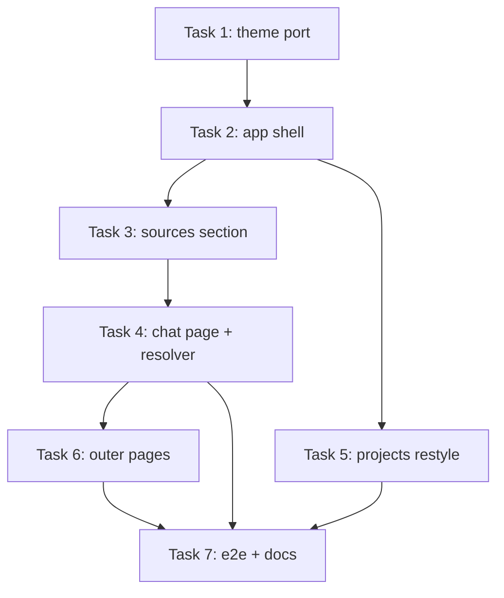

# UI Overhaul on the Official MUI Templates - Implementation Plan

> **For agentic workers:** REQUIRED SUB-SKILL: Use superpowers:subagent-driven-development (recommended) or superpowers:executing-plans to implement this plan task-by-task. Steps use checkbox (`- [ ]`) syntax for tracking.

**Goal:** Rebuild the web UI on the free official MUI templates (shared-theme, Dashboard shell, CRUD list styling, Marketing/Sign-in/Sign-up outer pages) so the old theme and layouts are fully gone.

**Architecture:** One shared `AppTheme` (CSS variables, light/dark) replaces the old theme; a new `AppShell` (permanent sidebar + topbar) frames project-scoped section routes (`/projects/:id/sources`, `.../chat`); a client-side resolver lands signed-in users on the latest chattable project's chat, else the latest project's sources. The project selection lives in the URL.

**Tech Stack:** React 19, MUI v9.5 (`@mui/material` + new `@mui/icons-material`), react-router 8, RTK Query, Vite, Vitest + Testing Library + MSW, Playwright.

**Spec:** `docs/superpowers/specs/2026-10-21-ui-mui-templates-design.md` (read it first; this plan argues from it).

## Global Constraints

- Template port sources are pinned: `https://raw.githubusercontent.com/mui/material-ui/v9.5.0/docs/data/material/getting-started/templates/<dir>/<file>.tsx` - port the `.tsx` variants, never `.js`.
- Dependencies: add ONLY `@mui/icons-material@^9`. Do NOT add `@mui/x-charts`, `@mui/x-data-grid`, `@mui/x-date-pickers`, `@mui/x-tree-view`, or `dayjs`. Remove `@fontsource/work-sans`; `@fontsource/inter` stays (the new theme uses Inter).
- No backend, API, or `web/src/test/handlers.ts` baseline changes. Tests override endpoints with `server.use(...)` only.
- UI copy rules (spec sections 8-10): new copy says "sources"/"files", never "documents"; disabled future items use the exact chip label "Coming soon"; the split button reads "Add source"; sign out stays "Sign out".
- Comments start with a capital letter and end with a dot; explain why, not what. No em dashes anywhere.
- Verification per task: `npm run lint` and the task's focused `npx vitest run <files>` in `web/`, then the full `npm test` before the task's final commit. Task 7 additionally runs `npm run format:check`, `npm run build`, and `npm run e2e`.
- One concern per commit; commit messages follow the repo's `type(scope): summary` style seen in `git log`.
- The baseline vitest run has one known flaky test under parallel load (ProjectPage polling assertion, documented in `docs/backlog.md`); re-run the single file before treating a failure as real.

## Review Focus

Failure classes the spec implies but per-task tests might miss - each is pinned by the named test:

1. A project's uploads fetch fails (500) while the resolver scans - the resolver must treat it as "not chattable" and fall through to latest sources, never hang. Pinned in Task 4, `ChatLanding` "treats a failing uploads fetch as not chattable".
2. Changing the project while deep in a section (`/sources/upload`) keeps the deep section, not just the section root. Pinned in Task 2, `ProjectSelect` "keeps the deep section when swapping projects".
3. Drag-and-drop with an empty or zero-file drop does nothing (no upload, no error alert). Pinned in Task 3, `UploadDropzone` "ignores an empty drop".
4. A same-name re-upload (server 409) surfaces the server copy in the dropzone Alert - the mutation error path, not only client-side rejections. Pinned in Task 3, `UploadDropzone` "shows the server rejection for a duplicate name", plus the journey e2e.
5. A deep link to a specific project's chat with nothing ready shows the empty state (no redirect away) and flips live once polling marks a row ready. Pinned in Task 4, `ChatPage` "flips from empty state to the panel when an upload turns ready".

---

### Task 1: Theme port + dependency swap

**Files:**
- Create: `web/src/theme/AppTheme.tsx`, `web/src/theme/themePrimitives.ts`, `web/src/theme/ColorModeIconDropdown.tsx`, `web/src/theme/customizations/{inputs,navigation,dataDisplay,feedback,surfaces}.tsx`, `web/src/theme/AppTheme.test.tsx`
- Modify: `web/src/app/App.tsx`, `web/src/test/test-utils.tsx`, `web/src/theme/global.css`, `web/package.json`
- Delete: `web/src/theme/theme.ts`, `web/src/theme/theme.test.tsx`

**Interfaces:**
- Produces: `export default function AppTheme(props: { children: ReactNode; themeComponents?: ThemeOptions["components"] }): JSX.Element` (port of `shared-theme/AppTheme.tsx` minus the docs-only `disableCustomTheme` prop); `ColorModeIconDropdown` default export; `themePrimitives.ts` exports `brand, gray, green, orange, red, colorSchemes, typography, shape, shadows` and the `declare module` blocks (drop `getDesignTokens` - unused); each customization file exports its named `*Customizations` const exactly as upstream.

- [ ] **Step 1: Swap dependencies**

Run in `web/`: `npm install @mui/icons-material@^9` then `npm uninstall @fontsource/work-sans`. Edit `web/src/theme/global.css` to import only `@fontsource/inter/400.css`, `/500.css`, and `/600.css` (600 is new - the template's heading weights need it) plus the existing `@import "tailwindcss";`.

- [ ] **Step 2: Write the failing theme test**

Create `web/src/theme/AppTheme.test.tsx` with three tests around a probe component that reads `useTheme()`:

```tsx
it("renders children under the template theme", ...); // probe asserts theme.palette.mode === "light"
it("applies the template typography and palette", ...); // fontFamily contains "Inter"; theme.palette.primary.main is the brand 400 string from themePrimitives
it("applies the ported component customizations", ...); // theme.components?.MuiMenuItem?.styleOverrides is defined (navigation customization)
```

- [ ] **Step 3: Run it to verify it fails**

Run: `npx vitest run src/theme/AppTheme.test.tsx`
Expected: FAIL (AppTheme.tsx does not exist).

- [ ] **Step 4: Port the shared theme**

Fetch and port from `.../templates/shared-theme/`: `AppTheme.tsx` (drop `disableCustomTheme`), `themePrimitives.ts` (drop `getDesignTokens`), `customizations/*.tsx` (all five, faithful), `ColorModeIconDropdown.tsx`. Adapt to repo lint (named imports per file, no unused vars). Then edit `web/src/app/App.tsx`: remove the `createTheme`/`ThemeProvider`/`createAppTheme` imports and wrap with `<AppTheme>` (CssBaseline and BrowserRouter stay inside). Edit `web/src/test/test-utils.tsx` the same way. Delete `theme.ts` and `theme.test.tsx`.

- [ ] **Step 5: Run the suite and lint**

Run: `npx vitest run src/theme/AppTheme.test.tsx` then full `npm test` and `npm run lint`.
Expected: all pass. Any test asserting old-theme specifics is updated to the new theme's facts (there should be none beyond the deleted `theme.test.tsx`).

- [ ] **Step 6: Commit**

```bash
git add -A
git commit -m "feat(web): replace the theme with the MUI shared-theme port"
```

### Task 2: App shell - sidebar, topbar, project select

**Files:**
- Create: `web/src/layouts/navItems.tsx`, `web/src/layouts/NavMenuContent.tsx`, `web/src/layouts/SideNav.tsx`, `web/src/layouts/SideNavMobile.tsx`, `web/src/layouts/ProjectSelect.tsx`, `web/src/layouts/AppShell.tsx`, `web/src/layouts/AppShell.test.tsx`, `web/src/layouts/ProjectSelect.test.tsx`
- Modify: `web/src/features/auth/UserMenu.tsx` + `UserMenu.test.tsx`, `web/src/app/AppRoutes.tsx`, `web/src/features/projects/ProjectsPage.tsx`, `web/src/features/projects/ProjectPage.tsx`
- Delete: `web/src/layouts/DashboardLayout.tsx`, `web/src/layouts/DashboardLayout.test.tsx`

**Interfaces:**
- Consumes: `AppTheme`, `ColorModeIconDropdown` (Task 1); `UserMenu` default export (modified in place).
- Produces: `NAV_ITEMS` array of `{ label: string; icon: ComponentType; to: string | null; comingSoon?: boolean }` (Projects `/projects` FolderRounded, Sources `/sources` UploadFileRounded, Chat `/chat` ChatBubbleRounded, Users `null` GroupRounded comingSoon, Analytics `null` InsightsRounded comingSoon); `AppShell` default export rendering `<Outlet/>`; `ProjectSelect` self-contained default export; `SideNavMobile({ open, onClose })`.

- [ ] **Step 1: Write failing shell tests**

`web/src/layouts/AppShell.test.tsx`: render `<AppShell/>` with stub routes at `/projects` (use `renderWithProviders` with a `MemoryRouter` route stub rendering AppShell around a placeholder); assert all five nav labels render, Users and Analytics buttons are disabled and both "Coming soon" chips are visible, and the topbar shows the mode-switcher button and the account avatar button. `web/src/layouts/ProjectSelect.test.tsx` (MSW: `GET */api/projects` -> `[p-2 "Research" 11:00, p-1 "Default" 10:00]`): assert the select renders "Default" when the route is `/projects/p-1/sources`; opening it lists "Research" before "Default"; selecting "Research" at route `/projects/p-1/sources/upload` navigates to `/projects/p-2/sources/upload`; selecting at `/projects` navigates to `/projects/p-2/sources`; with `GET */api/projects` -> `[]` the select is disabled showing "No projects".

- [ ] **Step 2: Run them to verify they fail**

Run: `npx vitest run src/layouts/AppShell.test.tsx src/layouts/ProjectSelect.test.tsx`
Expected: FAIL (files do not exist).

- [ ] **Step 3: Implement the shell**

Port references: `.../templates/dashboard/components/{SideMenu,SideMenuMobile,MenuButton,MenuContent,SelectContent}.tsx` and the `Dashboard.tsx` composition. Create `navItems.tsx` (the exact five items above), `NavMenuContent.tsx` (List of `ListItemButton`s; active detection via `useLocation` + `matchPath` prefix per section root; `comingSoon` items disabled with a small "Coming soon" `Chip`), `SideNav.tsx` (permanent `Drawer`, wordmark "RAG" on top), `SideNavMobile.tsx` (temporary `Drawer`, props `{ open, onClose }`), `ProjectSelect.tsx` (Select styled after `SelectContent`; sorts projects by `created_at` descending; selected value from `useParams().projectId` else the newest; `onChange` navigates keeping the deep suffix when the current path matches `/projects/:id/(sources|sources/upload|chat)`, else to `/projects/:id/sources`; disabled "No projects" placeholder when empty), `AppShell.tsx` (fixed `AppBar`: `MenuButton` hamburger hidden on `md`+ toggling `SideNavMobile`, `ProjectSelect`, spacer, `ColorModeIconDropdown`, `UserMenu`; permanent `SideNav`; main `Box` with `Toolbar` spacer and a `Container maxWidth="lg"` holding `<Outlet/>`; no footer). Update `UserMenu.tsx`: insert a disabled "Settings" `MenuItem` with a "Coming soon" `Chip` between the email subheader and "Sign out"; keep the sign-out logic and its comments byte-for-byte. Rewire `AppRoutes.tsx`: a pathless guarded layout route `<Route element={<RequireAuth><AppShell/></RequireAuth>}>` nesting the existing `/projects` and `/projects/:projectId` pages; landing/about/login/register and the `*` fallback stay outside. Remove the `DashboardLayout` wrapper from `ProjectsPage`/`ProjectPage` and delete `DashboardLayout.tsx` + its test.

- [ ] **Step 4: Run the suite and lint**

Run: `npx vitest run src/layouts` then full `npm test` and `npm run lint`.
Expected: all pass (old page tests still pass - pages render bare content now).

- [ ] **Step 5: Commit**

```bash
git add -A
git commit -m "feat(web): add the MUI dashboard shell with the project selector"
```

### Task 3: Sources section - index, add-source menu, file-upload page

**Files:**
- Create: `web/src/features/projects/NoProjectsState.tsx` + test, `web/src/features/sources/SourcesLanding.tsx` + test, `web/src/features/sources/SourcesPage.tsx` + test, `web/src/features/sources/AddSourceMenu.tsx` + test, `web/src/features/sources/SourceItemsTable.tsx` + test, `web/src/features/sources/UploadDropzone.tsx` + test, `web/src/features/sources/FileUploadPage.tsx` + test
- Modify: `web/src/app/AppRoutes.tsx`

**Interfaces:**
- Consumes: `AppShell` routes (Task 2); `useProjectUploads(projectId, { skip })`, `useUploadFileMutation`, `uploadRejection`, `MAX_UPLOAD_MB`, `statusChip`, `Upload` (existing).
- Produces: `NoProjectsState()` (copy "No projects yet", "Create project" button linking to `/projects`); `SourcesLanding()`; `SourcesPage()`; `AddSourceMenu({ projectId })`; `SourceItemsTable({ items: Upload[] })`; `UploadDropzone({ projectId })`; `FileUploadPage()`.

- [ ] **Step 1: Write failing tests**

Cover, with the baseline MSW fixtures (p-1 uploads: brief.pdf queued, report.docx ready, broken.pdf failed):

- `NoProjectsState.test.tsx`: renders the copy; the button links to `/projects`.
- `SourcesLanding.test.tsx`: with projects `[p-2 11:00, p-1 10:00]` renders a redirect to `/projects/p-2/sources` (assert via rendered location probe); with `[]` renders the NoProjectsState copy.
- `AddSourceMenu.test.tsx`: the "Add source" button opens a menu listing "File upload", "Website", "Google Drive"; Website and Google Drive are disabled and each shows a "Coming soon" chip; clicking "File upload" navigates to `/projects/p-1/sources/upload`.
- `SourceItemsTable.test.tsx`: renders rows with filename, Type column "File upload" on every row, a status chip, and the filename linking to `/projects/p-1/sources/upload`; with zero items renders "No source items yet.".
- `UploadDropzone.test.tsx`: change-event upload posts and shows no alert; "shows the client rejection copy" (oversize file via `uploadRejection`); "shows the server rejection for a duplicate name" (override `POST */api/projects/p-1/uploads` -> 409 `{detail: "..."}` and assert the Alert); "ignores an empty drop" (`fireEvent.drop` with `{ dataTransfer: { files: [] } }` - no POST, no alert); a two-file drop posts both sequentially (assert two POSTs via an MSW counter).
- `SourcesPage.test.tsx`: renders the toolbar (heading "Sources", search field, "Add source"), the three fixture rows; typing "report" in the search leaves only report.docx; the 404 case (override `GET */api/projects/p-1` -> 404) renders "Project not found." with the back-to-projects link.
- `FileUploadPage.test.tsx`: renders "Back to sources" linking to `/projects/p-1/sources`, heading "File upload", the dropzone, and the fixture rows; the 404 case renders "Project not found.".

- [ ] **Step 2: Run them to verify they fail**

Run: `npx vitest run src/features/sources src/features/projects/NoProjectsState.test.tsx`
Expected: FAIL (directory does not exist).

- [ ] **Step 3: Implement the sources feature**

Styling reference: `.../templates/crud-dashboard/components/EmployeeList.tsx` and `PageContainer.tsx` (toolbar + table-in-card look); behavior follows `ProjectsPage`/`ProjectPage` patterns (loading skeletons, retryable error card, empty state). Create all seven components per the Interfaces block: `AddSourceMenu` holds a `SOURCE_TYPES` const (`upload` -> navigates to `` `/projects/${projectId}/sources/upload` ``; website + gdrive disabled with "Coming soon"); `SourceItemsTable` columns: Filename (Link), Type ("File upload"), Status (`Chip` via `statusChip`), Created (`toLocaleDateString`); `UploadDropzone` ports `UploadCard`'s check/mutation/alert logic and adds `onDrop`/`onDragOver`: iterate `event.dataTransfer.files` in order, stop at the first rejection or mutation error (surface it in the Alert), upload the rest sequentially, plus the click path via the visually-hidden input (keep the tabIndex/-1 comment). Add routes to `AppRoutes.tsx` inside the shell group: `/sources` -> `SourcesLanding`, `/projects/:projectId/sources` -> `SourcesPage`, `/projects/:projectId/sources/upload` -> `FileUploadPage`. The old `/projects/:projectId` tab page stays until Task 4.

- [ ] **Step 4: Run the suite and lint**

Run: `npx vitest run src/features/sources src/features/projects` then full `npm test` and `npm run lint`.
Expected: all pass.

- [ ] **Step 5: Commit**

```bash
git add -A
git commit -m "feat(web): add the sources section with the add-source menu and upload dropzone"
```

### Task 4: Chat page, landing resolver, route swap

**Files:**
- Create: `web/src/features/chat/ChatPage.tsx` + test, `web/src/features/chat/ChatLanding.tsx` + test, `web/src/features/projects/ProjectRedirect.tsx` + test
- Modify: `web/src/app/AppRoutes.tsx`, `web/src/features/landing/LandingPage.tsx` + `LandingPage.test.tsx`, `web/src/features/auth/LoginPage.tsx`, `web/src/features/auth/RegisterPage.tsx`, `web/src/features/projects/ProjectsPage.tsx` (+ tests), `web/src/app/App.test.tsx`
- Delete: `web/src/features/projects/ProjectPage.tsx` + test, `web/src/features/uploads/UploadCard.tsx` + test, `web/src/features/uploads/UploadsTable.tsx`

**Interfaces:**
- Consumes: `NoProjectsState` (Task 3); `ChatPanel({ projectId })` (existing); `useProjectUploads` (existing); `Project`/`Upload` types.
- Produces: `ChatPage()`; `ChatLanding()`; `ProjectRedirect()`; route `/projects/:projectId` now redirects to `.../sources`; the three signed-in `Navigate` destinations (`LandingPage`, `LoginPage`, `RegisterPage`) become `/chat`.

- [ ] **Step 1: Write failing tests**

- `ChatPage.test.tsx`: "renders the panel when a source item is ready" (baseline p-1 uploads include ready report.docx - the chat textarea renders); "shows the empty state until a source item is ready" (override p-1 uploads to all `queued` - renders "Upload sources to start asking questions." and a "Go to sources" link to `/projects/p-1/sources`); "flips from empty state to the panel when an upload turns ready" (reuse `ProjectPage.test.tsx`'s fake-timer polling pattern: queued row flips to ready on the next poll); the 404 case renders "Project not found.".
- `ChatLanding.test.tsx`: "redirects to the newest chattable project's chat" (projects `[p-2 11:00, p-1 10:00]`, p-2 uploads -> ready, p-1 uploads -> ready: final URL `/projects/p-2/chat`); "falls back to the latest project's sources when none are chattable" (both projects' uploads -> queued: URL `/projects/p-2/sources`); "treats a failing uploads fetch as not chattable" covers both Review Focus cases: p-2 uploads -> 500 with p-1 uploads -> ready lands on `/projects/p-1/chat` (the walk continues past the failure), and p-2 uploads -> 500 with p-1 uploads -> all queued lands on `/projects/p-2/sources` (latest project, never hangs); "renders the no-project state" (`[]` -> NoProjectsState copy); "skips projects whose items are still processing" is the second test's premise (all-`queued` is not chattable).
- `ProjectRedirect.test.tsx`: at `/projects/p-1` the location becomes `/projects/p-1/sources`.
- Update `LandingPage.test.tsx` and `App.test.tsx`: the signed-in "/" visitor now ends on the resolver - with baseline `[]` projects that is the NoProjectsState copy, so override `GET */api/projects` -> `[p-1]` and assert the location is `/projects/p-1/chat` (p-1 is chattable in the baseline fixtures).

- [ ] **Step 2: Run them to verify they fail**

Run: `npx vitest run src/features/chat src/features/projects/ProjectRedirect.test.tsx`
Expected: FAIL (files do not exist).

- [ ] **Step 3: Implement the chat landing**

`ChatPage`: `useParams` -> `useGetProjectQuery` (404 state with back link) + `useProjectUploads(projectId, { skip: projectMissing })`; `hasReady = (uploads ?? []).some((u) => u.status === "ready")`; render `ChatPanel` when `hasReady`, else the empty state (`ChatBubbleRounded` icon, copy, "Go to sources" `Button component={RouterLink}` to `` `../sources` ``). `ChatLanding`: `useGetProjectsQuery`; sort newest-first; a `chattable: Record<string, boolean>` state; render one internal `ChattableProbe({ projectId, onResolved })` per project (each probe runs `useGetUploadsQuery(projectId)` and reports `uploads?.some(u => u.status === "ready") ?? false` on data OR error); when the newest-first walk finds a chattable project -> `<Navigate to={`/projects/${id}/chat`} replace />`; once every project resolved and none is chattable -> `<Navigate to={`/projects/${newest.id}/sources`} replace />`; `[]` -> `NoProjectsState`; an uncached projects error -> the retryable card ("Could not load projects." + Try again); while unresolved -> render the probes hidden plus `BootSplash`. Add routes: `/chat` -> `ChatLanding`, `/projects/:projectId` -> `ProjectRedirect`, `/projects/:projectId/chat` -> `ChatPage`. Change the three signed-in `Navigate to="/projects"` redirects to `/chat`. Change the `ProjectsPage` row link to `` `/projects/${project.id}/sources` ``. Delete `ProjectPage.tsx` + test, `UploadCard.tsx` + test, and `UploadsTable.tsx` (their replacements landed in Task 3).

- [ ] **Step 4: Run the suite and lint**

Run: `npx vitest run src/features/chat src/features/projects src/features/landing src/app` then full `npm test` and `npm run lint`.
Expected: all pass.

- [ ] **Step 5: Commit**

```bash
git add -A
git commit -m "feat(web): add the chat page and the latest-chattable-project landing resolver"
```

### Task 5: Projects page restyle

**Files:**
- Modify: `web/src/features/projects/ProjectsPage.tsx` + `ProjectsPage.test.tsx`

**Interfaces:**
- Consumes: existing `useGetProjectsQuery`, `CreateProjectDialog`, `EmptyProjects`, snackbar/error patterns.
- Produces: no interface change - same default export, restyled.

- [ ] **Step 1: Write the failing search test**

Add to `ProjectsPage.test.tsx`: "filters rows by the search field" - MSW returns `[p-1 "Alpha", p-2 "Beta"]`; typing "alp" leaves Alpha's row and removes Beta's; clearing the field restores both.

- [ ] **Step 2: Run it to verify it fails**

Run: `npx vitest run src/features/projects/ProjectsPage.test.tsx`
Expected: FAIL (no search field exists).

- [ ] **Step 3: Restyle the page**

Toolbar per the CRUD template look: heading "Projects" with a `TextField` (label "Search projects", `size="small"`) and the "New project" contained button on the right; client-side case-insensitive name filter; wrap the table in the template's rounded outlined `Card` (matching `SourceItemsTable`); keep the skeleton rows, `EmptyProjects`, error card, and snackbar logic unchanged.

- [ ] **Step 4: Run the suite and lint**

Run: `npx vitest run src/features/projects` then full `npm test` and `npm run lint`.
Expected: all pass.

- [ ] **Step 5: Commit**

```bash
git add -A
git commit -m "feat(web): restyle the projects list with search and the CRUD toolbar"
```

### Task 6: Outer pages on the official templates

**Files:**
- Create: `web/src/layouts/MarketingFrame.tsx` + test, `web/src/layouts/AuthFrame.tsx` + test
- Modify: `web/src/features/landing/LandingPage.tsx` + test, `web/src/features/about/AboutPage.tsx` + test, `web/src/features/auth/LoginPage.tsx` + test, `web/src/features/auth/RegisterPage.tsx` + test
- Delete: `web/src/layouts/MarketingLayout.tsx` + test, `web/src/layouts/AuthLayout.tsx` + test, `web/src/layouts/SiteFooter.tsx` + test

**Interfaces:**
- Consumes: `ColorModeIconDropdown` (Task 1); the pages' existing auth logic and copy.
- Produces: `MarketingFrame({ children })` (marketing navbar + footer), `AuthFrame({ children })` (centered sign-in frame); no other exports.

- [ ] **Step 1: Write failing frame tests**

`MarketingFrame.test.tsx`: renders the wordmark "RAG" linking to `/`, an "About" link, the mode switcher, "Sign in" linking `/login`, "Get started" linking `/register`, children, and the footer copyright. `AuthFrame.test.tsx`: renders the wordmark, the mode switcher, and children inside a card.

- [ ] **Step 2: Run them to verify they fail**

Run: `npx vitest run src/layouts/MarketingFrame.test.tsx src/layouts/AuthFrame.test.tsx`
Expected: FAIL (files do not exist).

- [ ] **Step 3: Build the frames and rebuild the pages**

Port references: `.../templates/marketing-page/components/{AppAppBar,Hero,Features,Footer}.tsx` (skip Pricing/Testimonials/FAQ/Highlights/LogoCollection - no content for them, spec section 10) and `.../templates/sign-in/SignIn.tsx` (take the layout shell only - our forms have no social buttons or forgot-password). Create `MarketingFrame.tsx` (AppAppBar structure: "RAG" wordmark, "About" link, `ColorModeIconDropdown`, Sign in / Get started buttons; `Container maxWidth="md"`-ish content slot; Footer structure reduced to wordmark + one-line description + copyright) and `AuthFrame.tsx` (full-height centered `Stack maxWidth="xs"`: mode switcher pinned top-right, wordmark, `Card variant="outlined"` with children). Rebuild `LandingPage.tsx` on `MarketingFrame`: hero section with the current headline/subtitle/CTAs and a features section with the existing three steps (add `PostAddRounded`, `UploadFileRounded`, `ChatBubbleRounded` icons); keep the signed-in redirect (target `/chat` from Task 4). Rebuild `AboutPage.tsx` on `MarketingFrame` with the current copy. Swap `AuthLayout` -> `AuthFrame` in `LoginPage.tsx`/`RegisterPage.tsx` (all form logic, labels, error copy, and the 401/409 handling stay; the signed-in `Navigate` target stays `/chat`). Delete `MarketingLayout`, `AuthLayout`, `SiteFooter` and their tests.

- [ ] **Step 4: Run the suite and lint**

Run: `npx vitest run src/layouts src/features/landing src/features/about src/features/auth` then full `npm test` and `npm run lint`.
Expected: all pass (landing/auth page tests keep passing with only structural selector updates).

- [ ] **Step 5: Commit**

```bash
git add -A
git commit -m "feat(web): rebuild the landing, about, and auth pages on the official templates"
```

### Task 7: E2e rewrite + docs pass

**Files:**
- Modify: `web/e2e/journey.spec.ts`, `web/e2e/enforcement.spec.ts`, `docs/2026-10-19-system-overview.md`, `docs/superpowers/specs/2026-10-06-roadmap.md`, `docs/backlog.md`

**Interfaces:**
- Consumes: the finished UI from Tasks 1-6.

- [ ] **Step 1: Rewrite the e2e journey**

Update `journey.spec.ts` for the new flow: `register()` asserts the URL is `/projects/[^/]+/sources$` (resolver: fresh user -> default project's sources). Test 1: register -> sidebar "Projects" -> the "Default" row -> create "Research notes" via the dialog -> sign out via the account menu (unchanged selectors: `/account menu/i`, "Sign out") -> landing heading -> token revoked -> the 409 register copy. Test 2: register -> "Add source" -> "File upload" -> dropzone input `setInputFiles` tiny.pdf and sample.docx -> both rows reach "Ready" (no tabs exist anymore - drop the tab-pinning dance) -> same-name re-upload shows the 409 alert and keeps two rows -> sidebar "Chat" -> ask a question -> stub answer -> expand "Sources (n)" -> the tiny.pdf and sample.docx source buttons. Add to `enforcement.spec.ts`: logged-out `/sources` redirects to `/login`; update the register/re-login URL assertions to the sources landing and reach the projects list via the sidebar.

- [ ] **Step 2: Run the e2e suite**

With the compose stack running per the repo runbook, run in `web/`: `npm run e2e`.
Expected: all journey and enforcement tests pass.

- [ ] **Step 3: Full verification**

Run in `web/`: `npm run lint`, `npm test`, `npm run format:check`, `npm run build`.
Expected: all pass. Fix formatting drift only (`npm run format`), never logic, without a separate commit - fold it into this task's commits.

- [ ] **Step 4: Docs pass**

Update `docs/2026-10-19-system-overview.md`: rewrite the web/UI paragraphs and the API table's "UI usage" column for the new shell, pages, and resolver (service topology and API contract unchanged). Append the slice to `docs/superpowers/specs/2026-10-06-roadmap.md`'s slice table (post-S5 UI restructure, frontend-only by user decision) and refresh its "Next step" section. Update `docs/backlog.md`: mark resolved the "documents" naming note, the S5 tab-a11y note, and the S2 visual-pass note; add a timestamped section for this slice's residuals (including a fresh human visual pass on the new UI) with commit links, recording the spec's three follow-ups there: project edit/delete UI (a later slice), Users/Analytics content slices (each brings its `@mui/x-*` dependency with it), and a per-source-type items endpoint once a second source type arrives.

- [ ] **Step 5: Commit**

```bash
git add -A
git commit -m "test(web): rewrite the e2e journey for the template shell and update the docs"
```

## Task DAG



Task 5 is independent of Tasks 3-4 and may run in parallel with them; everything else is sequential. Tasks 1-4 and 6 may each land as working software on their own; Task 7 closes the loop.
