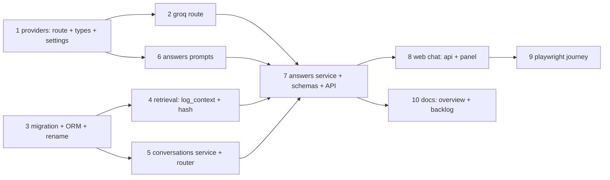

# S6 - Multi-turn conversations + LLM-routed answers - Implementation Plan

> **For agentic workers:** REQUIRED SUB-SKILL: Use superpowers:subagent-driven-development (recommended) or superpowers:executing-plans to implement this plan task-by-task. Steps use checkbox (`- [ ]`) syntax for tracking.

**Goal:** Store conversations server-side (messages + inline evidence snapshots), let an LLM router pick DIRECT / REUSE / RETRIIEVE per turn, and hydrate the owner's latest conversation in the chat UI, so a discussion survives reload and follow-ups resolve against it.

**Architecture:** A new `app/conversations` package owns persistence (three tables, one migration, which also renames `query_logs` -> `retrieve_logs`). The answer service routes before answering: router -> three paths (direct answer / reuse gathered snapshots / retrieve rewritten query) -> one transaction appending the turn. The provider interface gains `route()` and message-list `generate()`; the chat frontend fetches latest on mount, sends `conversation_id`, and gains a "New chat" action.

**Tech Stack:** FastAPI, SQLAlchemy 2.0 sync, Alembic, Postgres 17 + pgvector, httpx (Groq), pytest against real Postgres; React + RTK Query + MUI, vitest + MSW, Playwright.

**Spec:** `docs/superpowers/specs/2026-10-23-s6-multi-turn-conversations-design.md` - the plan argues from the spec; executors read both. Roadmap: `docs/superpowers/specs/2026-10-06-roadmap.md` (decision 8 re-cut).

## Global Constraints

- Line length 110 (ruff); every module/class/function has a docstring followed by a blank line (private ones too).
- All function parameters keyword-only (`def f(*, a, b)`); third-party calls positional too. `# type: ignore` only when necessary.
- Comments start with a capital letter, end with a dot, explain why. Never the em dash "—" - plain dash "-".
- Settings via `app/core/config.py` `Settings` (env prefix `RAG_`), validated as the spec's table pins.
- Tests run against real Postgres from compose (never SQLite); API tests via TestClient + `db_session`/`client` fixtures from `tests/conftest.py`.
- pytest pins `RAG_LLM_PROVIDER=stub`, `RAG_ENVIRONMENT=dev`; the suite stays offline.
- One concern per commit; each task = at least one commit, message in the task.
- Backend gates from `backend/`: `ruff check .`, `ruff format --check .`, `mypy app tests`, `python -m pytest <scope> -v`. Web gates from `web/`: `npm run test`, `npm run lint`, `npm run e2e`.
- Worktrees: named branch before the first commit (AGENTS.md). This branch: `s6-multi-turn-conversations`.

## Review Focus

The spec implies these inputs; the named tests pin them. Each line names the input, the expected behavior, and the task whose tests exercise it.

1. **A second send with `conversation_id: null` while a conversation already exists** - must resolve to the existing latest conversation (append), never create a duplicate: `test_resolve_null_reuses_latest_conversation` (Task 5).
2. **Two concurrent `append_turn` calls on one conversation** - both persist with distinct positions, no 500: `test_append_turn_concurrent_sends_serialize` (Task 5).
3. **A router reply with a blank `rewritten_query` on RETRIEVE, or garbage JSON** - falls back to RETRIEVE with the raw question, `router_fallback: true` logged: `test_route_blank_rewritten_query_falls_back` (Task 2), `test_router_error_falls_back_to_retrieve` (Task 7).
4. **The same chunk cited in several turns, then REUSE** - gathered once (dedupe by `chunk_id`), and the router prompt sees the same gathered set the answer call reuses: `test_gather_snapshots_dedupes_and_caps` (Task 5), `test_reuse_gathers_for_router_and_answer` (Task 7).
5. **Re-ingestion deletes a cited chunk row after answers exist** - snapshot rows survive (`ON DELETE SET NULL`), the hydrated thread still renders, REUSE still answers from the inline text: `test_migration_chunk_fk_is_set_null` (Task 3), `test_snapshot_survives_chunk_replacement` (Task 5).

## Task DAG



Parallel starts: {1, 3}. After 3: {4, 5}. After 1: {2, 6}. 7 joins them; 8 -> 9; 10 last.

---

### Task 1: Provider types, `route()`, stub, settings

**Files:**
- Modify: `backend/app/providers/base.py`, `backend/app/providers/stub_llm.py`, `backend/app/core/config.py`
- Test: `backend/tests/providers/test_stub_llm.py`

**Interfaces:**
- Produces: `ChatMessage` dataclass `{role: Literal["user", "assistant"], content: str}` and `RouteDecision` dataclass `{route: Literal["direct", "reuse", "retrieve"], rewritten_query: str | None}` in `app/providers/base.py`; `LLMProvider.route(*, system: str, messages: list[ChatMessage]) -> RouteDecision`; `StubLLMProvider.route` returning `RouteDecision(route="retrieve", rewritten_query=None)`. `generate(*, system, user) -> str` stays; the messages-list switch is Task 7.
- Produces settings: `answer_history_messages: int = Field(default=6, ge=1)`, `answer_reuse_max_chunks: int = Field(default=10, ge=1)`, `llm_route_max_tokens: int = Field(default=128, gt=0)`, `llm_route_timeout_seconds: float = Field(default=10.0, gt=0)`.

- [ ] **Step 1: Write the failing test**

In `backend/tests/providers/test_stub_llm.py` add:

```python
def test_stub_route_always_retrieves_with_raw_query() -> None:
    """The stub router keeps the offline path on today's retrieval behavior."""
    decision = StubLLMProvider().route(system="s", messages=[ChatMessage(role="user", content="q")])
    assert decision == RouteDecision(route="retrieve", rewritten_query=None)
```

- [ ] **Step 2: Run test to verify it fails**

Run: `python -m pytest tests/providers/test_stub_llm.py -v` (from `backend/`)
Expected: FAIL with `AttributeError: ... has no attribute 'route'`

- [ ] **Step 3: Implement**

Add the two dataclasses and `route` to the `LLMProvider` Protocol in `base.py` (after `LLMError`); export both from `app/providers/__init__.py`'s import + `__all__`. Add `StubLLMProvider.route` (docstring: returns the fixed RETRIEVE decision so dev and e2e keep retrieval). Add the four settings fields after `answer_max_chunks_per_document`, each with a one-line comment naming its spec role (history trim / REUSE cap / router cost guard / router timeout inside nginx's 60s budget with the 30s answer call).

- [ ] **Step 4: Run test to verify it passes**

Run: `python -m pytest tests/providers/test_stub_llm.py -v`
Expected: PASS

- [ ] **Step 5: Gate + commit**

Run: `ruff check .`, `ruff format --check .`, `mypy app tests`, `python -m pytest tests/providers -v`

```bash
git add backend/app/providers/base.py backend/app/providers/stub_llm.py backend/app/providers/__init__.py backend/app/core/config.py backend/tests/providers/test_stub_llm.py
git commit -m "feat: add the LLM route decision types, stub route, and answer conversation settings"
```

### Task 2: Groq `route()` with shared `_complete`

**Files:**
- Modify: `backend/app/providers/groq_llm.py`, `backend/app/providers/__init__.py`
- Test: `backend/tests/providers/test_groq_llm.py`

**Interfaces:**
- Consumes: Task 1's `RouteDecision`, `ChatMessage`, `llm_route_max_tokens`, `llm_route_timeout_seconds`.
- Produces: `GroqLLMProvider.__init__(*, api_key, base_url, model, timeout_seconds, max_tokens, route_max_tokens, route_timeout_seconds, transport=None)` - the factory in `__init__.py` passes both new values from settings. `GroqLLMProvider._complete(*, messages: list[dict[str, str]], max_tokens: int, timeout_seconds: float) -> str` shared by both calls; `route(*, system, messages) -> RouteDecision`; `generate(*, system, user)` unchanged this task.

- [ ] **Step 1: Write the failing tests**

In `test_groq_llm.py` add: `test_route_parses_valid_decision` (MockTransport serving `{"choices":[{"message":{"content":"{\"route\": \"retrieve\", \"rewritten_query\": \"standalone q\"}"}}]}`; assert `RouteDecision(route="retrieve", rewritten_query="standalone q")`); `test_route_rejects_garbage_json` (content `"route: retrieve"` -> `LLMError`); `test_route_rejects_unknown_route_literal` (`{"route": "teleport"}` -> `LLMError`); `test_route_rejects_blank_rewritten_query` (`{"route": "retrieve", "rewritten_query": "  "}` -> `LLMError`); `test_route_rejects_missing_rewritten_query_on_reuse` (`{"route": "reuse"}` -> `LLMError`); `test_route_payload_carries_route_max_tokens_and_timeout` (assert the request JSON `max_tokens == 128`); `test_route_maps_http_errors_to_llm_error` (429 -> `LLMError` with `GROQ_ERROR_COPY`).

- [ ] **Step 2: Run tests to verify they fail**

Run: `python -m pytest tests/providers/test_groq_llm.py -v`
Expected: FAIL with `TypeError` (missing `route_max_tokens`) / `AttributeError` (no `route`)

- [ ] **Step 3: Implement**

Refactor the POST body of `generate` into `_complete(*, messages, max_tokens, timeout_seconds)` (messages are plain dicts rendered from `ChatMessage`; build once in a module helper `_message_dicts(*, system, messages)`). `route` calls `_complete` with `route_max_tokens` / `route_timeout_seconds`, JSON-parses the content, and validates: route literal in the three, `rewritten_query` non-blank when route is `retrieve`, and `rewritten_query` may be absent/null for `direct`/`reuse`. Any failure raises `LLMError(GROQ_ERROR_COPY)` with the cause chained. `__init__` stores the two route knobs; per-call `timeout=` on `self._client.post` replaces the client-level default (the answer call keeps `timeout_seconds`).

- [ ] **Step 4: Run tests to verify they pass**

Run: `python -m pytest tests/providers/test_groq_llm.py -v`
Expected: PASS

- [ ] **Step 5: Gate + commit**

Run: `ruff check .`, `ruff format --check .`, `mypy app tests`, `python -m pytest tests/providers -v`

```bash
git add backend/app/providers/groq_llm.py backend/app/providers/__init__.py backend/tests/providers/test_groq_llm.py
git commit -m "feat: route turns through the Groq chat endpoint with a defensive JSON contract"
```

### Task 3: Migration 0007 + ORM models + `query_logs` rename

**Files:**
- Create: `backend/alembic/versions/0007_conversations.py`, `backend/app/conversations/__init__.py`, `backend/app/conversations/models.py`
- Modify: `backend/app/retrieval/models.py` (rename), `backend/app/retrieval/service.py` (import), `backend/tests/test_alembic.py`, `backend/tests/retrieval/*`, `backend/tests/answers/*` (rename sweep)
- Test: `backend/tests/test_alembic.py`

**Interfaces:**
- Produces ORM: `Conversation` (`conversations`; `id`, `project_id` FK cascade, `user_id` FK no action, `created_at`, `last_message_at` non-null server-default `now()`); `ConversationMessage` (`conversation_messages`; `id`, `conversation_id` FK cascade, `position` int, `role` text check user/assistant, `content` text, `route` nullable text check, `created_at`; unique `(conversation_id, position)`); `ConversationMessageChunk` (`conversation_message_chunks`; `id`, `message_id` FK cascade, `ordinal`, `chunk_id` FK `chunks.id` ON DELETE SET NULL, `filename`, `heading_path` JSONB, `text`, `document_content_hash`; unique `(message_id, ordinal)`). Indexes: `ix_conversations_project_id_user_id_last_message_at (project_id, user_id, last_message_at)`, `ix_conversations_user_id`, `ix_conversation_message_chunks_chunk_id` - the messages/chunks FK lookups ride the composite uniques, whose leading columns they are (spec section 3).
- Produces rename: `QueryLog` -> `RetrieveLog`, `__tablename__ = "retrieve_logs"`, indexes `ix_retrieve_logs_project_id_created_at` / `ix_retrieve_logs_user_id`.

- [ ] **Step 1: Write the failing tests**

Update `tests/test_alembic.py`: in `test_query_logs_table_exists` (rename to `test_retrieve_logs_table_exists`) assert `"retrieve_logs"` in table names; add `test_conversation_tables_exist` asserting the three new names; extend `test_foreign_key_columns_are_indexed`'s `expected` dict with `"conversations": {"project_id", "user_id"}`, `"conversation_messages": {"conversation_id"}`, `"conversation_message_chunks": {"message_id", "chunk_id"}`, and rename the `"query_logs"` key to `"retrieve_logs"` (the composite uniques satisfy the messages/chunks FKs as leading columns, exactly like `team_memberships.team_id` today). Add `test_migration_chunk_fk_is_set_null`: upgrade, then inspect `conversation_message_chunks` foreign keys (raw `information_schema`/`pg_catalog` query) and assert the chunk FK's `on_delete == "SET NULL"`. `test_models_match_migrations` covers the new ORM models automatically once they exist.

- [ ] **Step 2: Run tests to verify they fail**

Run: `python -m pytest tests/test_alembic.py -v`
Expected: FAIL (`retrieve_logs` absent, conversation tables absent)

- [ ] **Step 3: Implement the migration + models**

`0007_conversations.py` (`revision: str = "0007"`, `down_revision = "0006"`), `upgrade()`: `op.rename_table("query_logs", "retrieve_logs")`; `op.execute("ALTER INDEX ix_query_logs_project_id_created_at RENAME TO ix_retrieve_logs_project_id_created_at")` and the `user_id` twin (Postgres keeps index names on table rename, so the explicit renames keep ORM names honest); then `op.create_table` x3 mirroring the ORM block above (server-default `sa.text("now()")` on `created_at` and `last_message_at`), checks via `sa.CheckConstraint`, uniques `(conversation_id, position)` / `(message_id, ordinal)`, and `op.create_index` x3 (the two conversation indexes + `ix_conversation_message_chunks_chunk_id`). `downgrade()` reverses in reverse order. Write the three ORM models in `app/conversations/models.py` with the staleness comment at the snapshot columns (spec decision 8):

```python
# Staleness is known and deferred (spec decision 8): re-ingestion replaces chunk rows,
# so text/filename/heading_path/document_content_hash are the durable citation and
# chunk_id only links while the original row lives. No re-validation this round.
```

Rename in `app/retrieval/models.py` (class + `__tablename__` + both index names) and its import in `app/retrieval/service.py` (`from app.retrieval.models import RetrieveLog`, the `_log_query` reference). Sweep every `QueryLog` import/reference across `tests/retrieval/`, `tests/answers/` (grep: `QueryLog|query_logs`).

- [ ] **Step 4: Run tests to verify they pass**

Run: `python -m pytest tests/test_alembic.py tests/retrieval tests/answers -v`
Expected: PASS

- [ ] **Step 5: Gate + commit**

Run: `ruff check .`, `ruff format --check .`, `mypy app tests`, `python -m pytest tests/test_alembic.py -v`

```bash
git add backend/alembic/versions/0007_conversations.py backend/app/conversations backend/app/retrieval backend/tests
git commit -m "feat: add conversations schema and rename query logs to retrieve logs"
```

### Task 4: Retrieval `log_context` + `document_content_hash`

**Files:**
- Modify: `backend/app/retrieval/service.py`
- Test: `backend/tests/retrieval/test_service.py`

**Interfaces:**
- Consumes: Task 3's `RetrieveLog`.
- Produces: `retrieve(*, db, project_id, user_id, params, settings, origin: str = "direct", log_context: Mapping[str, str] | None = None)`; `RetrievedChunk` gains `document_content_hash: str`; `_enrich` joins `Document.content_hash`; `_log_query` merges `log_context` into `params` top level.

- [ ] **Step 1: Write the failing tests**

In `tests/retrieval/test_service.py` add: `test_log_context_merges_into_params` (call `retrieve(..., origin="answer", log_context={"route": "retrieve", "raw_query": "q", "router_fallback": "true"})`; assert the log row's `params` carries those keys alongside `origin`; direct calls with no `log_context` keep today's `params` shape - extend the existing origin test); `test_retrieved_chunk_carries_document_hash` (seed a document, retrieve, assert `chunks[0].document_content_hash == seeded document's content_hash`).

- [ ] **Step 2: Run tests to verify they fail**

Run: `python -m pytest tests/retrieval/test_service.py -v`
Expected: FAIL (`Unexpected keyword argument 'log_context'`, missing field)

- [ ] **Step 3: Implement**

`_enrich` selects `Document.content_hash` in the same join and adds it to `RetrievedChunk` (field last, after `score`). `retrieve` threads `log_context` into `_log_query`, which does `params={**base_params, **(log_context or {})}`. Keep the docstring note that `log_context` keeps answer-layer concepts out of this module.

- [ ] **Step 4: Run tests to verify they pass**

Run: `python -m pytest tests/retrieval -v`
Expected: PASS

- [ ] **Step 5: Gate + commit**

Run: `ruff check .`, `ruff format --check .`, `mypy app tests`

```bash
git add backend/app/retrieval/service.py backend/tests/retrieval/test_service.py
git commit -m "feat: thread log context and document hashes through retrieval"
```

### Task 5: Conversations service + router

**Files:**
- Create: `backend/app/conversations/schemas.py`, `backend/app/conversations/service.py`, `backend/app/conversations/router.py`
- Modify: `backend/app/main.py` (include router)
- Test: `backend/tests/conversations/test_service.py`, `backend/tests/conversations/test_conversations_api.py`

**Interfaces:**
- Consumes: Task 3 models; `get_project_visible_to_user` (`app/projects/service.py`); `get_current_user`.
- Produces (`app/conversations/service.py`):
  - `create_conversation(*, db: Session, project_id: UUID, user_id: UUID) -> Conversation` (commit; returns the empty row)
  - `get_latest_conversation(*, db: Session, project_id: UUID, user_id: UUID) -> Conversation | None` (`ORDER BY last_message_at DESC` one row)
  - `resolve_conversation(*, db: Session, project_id: UUID, user_id: UUID, conversation_id: UUID | None) -> Conversation | None` (null -> latest-or-create, always a row; explicit -> owned row in this project or `None` for the caller to 404)
  - `gather_snapshots(*, db: Session, conversation_id: UUID, max_chunks: int) -> list[ConversationMessageChunk]` (most-recent-first over assistant messages, dedupe by `chunk_id` - null `chunk_id` rows dedupe by `(text, filename)` - cap, returned in citation order; the `[1..n]` renumbering is positional, no ordinals are persisted)
  - `append_turn(*, db: Session, conversation: Conversation, question: str, answer: str, route: str, snapshots: Sequence[SnapshotIn]) -> None` (one transaction; `SELECT ... FOR UPDATE` on the conversation row; `position = max + 1` and `+ 1`; writes both messages, the snapshot rows, bumps `last_message_at`; commit)
  - `load_history(*, db: Session, conversation_id: UUID, limit: int) -> list[ChatMessage]` (last N messages oldest-first, content stripped of `[n]` citation markers)
- Produces (`app/conversations/schemas.py`): `SnapshotChunkOut {chunk_id: UUID | None, filename: str, heading_path: list[str], text: str, document_content_hash: str}`, `MessageOut {role, content, route: str | None, chunks: list[SnapshotChunkOut]}`, `ConversationCreatedOut {conversation_id}`, `LatestConversationOut {conversation_id, messages: list[MessageOut]}`.
- Produces (`app/conversations/router.py`): `POST /projects/{project_id}/conversations` -> 201 `ConversationCreatedOut`; `GET /projects/{project_id}/conversations/latest` -> 200 `LatestConversationOut` or `404 "no conversation yet"`.
- Produces a `SnapshotIn` frozen dataclass in `app/conversations/service.py`: `{chunk_id: UUID | None, filename: str, heading_path: list[str], text: str, document_content_hash: str}` - the answer service builds it from `RetrievedChunk` (Task 7) or gathered snapshot rows.

- [ ] **Step 1: Write the failing tests**

`tests/conversations/test_service.py`:
- `test_create_and_get_latest_round_trip`: create -> `get_latest_conversation` returns it; `last_message_at` non-null.
- `test_get_latest_none_when_user_has_no_conversation`.
- `test_resolve_null_creates_when_none_exists` + `test_resolve_null_reuses_latest_conversation` (Review Focus 1).
- `test_resolve_explicit_rejects_foreign_conversation` (another user's row -> `None`; cross-project -> `None`).
- `test_append_turn_writes_messages_snapshots_and_bumps` (positions 1, 2; route on assistant only; `last_message_at` moved; one commit - assert via `db_session.flush` visibility after a fresh `Session` query or rollback behavior).
- `test_append_turn_concurrent_sends_serialize` (Review Focus 2): two `Session(bind=engine)` + `ThreadPoolExecutor`, both `append_turn` the same conversation, assert 4 messages with positions {1, 2}; cleanup with a third session `DELETE`.
- `test_gather_snapshots_dedupes_and_caps` (Review Focus 4): seed two assistant messages citing an overlapping `chunk_id`, cap 2, assert dedupe + most-recent-first + ordinals 1..n.
- `test_snapshot_survives_chunk_replacement` (Review Focus 5): append a turn citing a real `chunk_id`, delete the `Chunk` row, re-query the snapshot: row alive, `chunk_id` null, text intact.
- `test_load_history_strips_citation_markers` and limit behavior (last N, oldest-first).

`tests/conversations/test_conversations_api.py`:
- `test_post_conversations_creates_owned_empty_conversation` (201, `user_id` is the caller; second user's `GET latest` still 404s - isolation).
- `test_get_latest_returns_messages_in_order_with_chunks` (seed via `append_turn`; assert `MessageOut` shape and snapshot `chunks`).
- `test_get_latest_404_when_none`.
- `test_post_and_get_latest_404_on_invisible_project`.
- `test_routes_require_auth` (401 both).

- [ ] **Step 2: Run tests to verify they fail**

Run: `python -m pytest tests/conversations -v`
Expected: FAIL (package missing)

- [ ] **Step 3: Implement**

Service per the Interfaces block. Two mandated comments (user instruction):

```python
# The conversation row joins this transaction on the null path: a failed answer call
# must persist nothing, not even an empty conversation (spec decision 14).
```

at the `append_turn` docstring/transaction, and on `resolve_conversation`:

```python
# conversation_id arrives null only before hydration resolves: first entry into a
# project's chat, or a submit racing the GET-latest fetch. Null always means
# latest-or-create, never create-new, so the race resolves to the existing row.
```

`append_turn` order: `db.execute(select(Conversation).where(...).with_for_update())` -> recompute `last_message_at`/`position` -> adds -> `db.commit()`. `load_history` and `gather_snapshots` end with `db.commit()` (read-only close) so no transaction stays open across LLM calls (spec decision 14). Router mirrors `app/answers/router.py`: visibility check -> 404, then service; include in `app/main.py` under the `/api` prefix.

- [ ] **Step 4: Run tests to verify they pass**

Run: `python -m pytest tests/conversations -v`
Expected: PASS

- [ ] **Step 5: Gate + commit**

Run: `ruff check .`, `ruff format --check .`, `mypy app tests`, `python -m pytest -v`

```bash
git add backend/app/conversations backend/app/main.py backend/tests/conversations
git commit -m "feat: store and serve per-user project conversations"
```

### Task 6: Answers prompts

**Files:**
- Modify: `backend/app/answers/prompt.py`
- Test: `backend/tests/answers/test_prompt.py`

**Interfaces:**
- Consumes: `ChatMessage` (Task 1).
- Produces: `ContextBlock` frozen dataclass in `prompt.py` - `{filename: str, heading_path: list[str], text: str}` - the one shape both fresh `RetrievedChunk`s and gathered snapshot rows map into (mapping lives in the service, Task 7). `ROUTER_SYSTEM_PROMPT` (three-route semantics + strict-JSON `{"route": ..., "rewritten_query": ...}` contract + "prefer RETRIEVE when unsure"); `SYSTEM_PROMPT_DIRECT` (answer from conversation history; no passages; be concise); `build_route_messages(*, question: str, history: list[ChatMessage], evidence: Sequence[ContextBlock]) -> list[ChatMessage]` (history, then one `EVIDENCE_SUMMARY` message listing `[{n}] filename - headings: <first 200 chars of text>` per block, then the question as the final user message); `build_answer_messages(*, question: str, history: list[ChatMessage], blocks: Sequence[ContextBlock]) -> list[ChatMessage]` (history, then the final user message = today's `Question:` + numbered `[n] filename - heading
text` blocks); existing `SYSTEM_PROMPT` + `build_user_prompt` unchanged. Module constant `EVIDENCE_PREVIEW_CHARS: Final = 200`.

- [ ] **Step 1: Write the failing tests**

In `tests/answers/test_prompt.py` add: `test_route_messages_contain_history_evidence_and_question` (assert order: history messages first, evidence block, question last; evidence rows truncated at 200); `test_router_system_prompt_states_contract` (contains `direct`, `reuse`, `retrieve`, `rewritten_query`, strict JSON instruction); `test_direct_system_prompt_has_no_passages`; `test_answer_messages_history_then_question_blocks` (blocks numbered `[1]..` in order after `Question:`; history precedes); `test_history_markers_stripped` (history containing `[2]` passes clean text through).

- [ ] **Step 2: Run tests to verify they fail**

Run: `python -m pytest tests/answers/test_prompt.py -v`
Expected: FAIL (names missing)

- [ ] **Step 3: Implement**

Pure functions, no SQLAlchemy. `_render_block` generalizes: history content is already stripped (Task 5 `load_history`), evidence preview uses the first `EVIDENCE_PREVIEW_CHARS` characters per passage.

- [ ] **Step 4: Run tests to verify they pass**

Run: `python -m pytest tests/answers/test_prompt.py -v`
Expected: PASS

- [ ] **Step 5: Gate + commit**

Run: `ruff check .`, `ruff format --check .`, `mypy app tests`

```bash
git add backend/app/answers/prompt.py backend/tests/answers/test_prompt.py
git commit -m "feat: prompt the router and the history-aware answer turns"
```

### Task 7: Answers service rework + API contract

**Files:**
- Modify: `backend/app/answers/schemas.py`, `backend/app/answers/service.py`, `backend/app/answers/router.py`, `backend/app/providers/base.py` + `stub_llm.py` + `groq_llm.py` (generate switch), `backend/tests/fakes.py`, `backend/app/providers/__init__.py`
- Test: `backend/tests/answers/test_service.py`, `backend/tests/answers/test_answer_api.py`, `backend/tests/providers/test_stub_llm.py`, `backend/tests/providers/test_groq_llm.py`

**Interfaces:**
- Consumes: Tasks 1-6 (`resolve_conversation`, `gather_snapshots`, `append_turn`, `load_history`, prompts, `retrieve(..., log_context=...)`, `RetrievedChunk.document_content_hash`).
- Produces: `AnswerIn` gains `conversation_id: UUID | None = None`; `AnswerOut` = `{answer: str, route: Literal["direct", "reuse", "retrieve"], conversation_id: UUID, chunks: list[SnapshotChunkOut]}` (import from `app.conversations.schemas`); `generate_answer(*, db, project_id, user_id, params: AnswerIn, settings) -> Answer` where `Answer` = `{text, route: str, conversation_id: UUID, chunks: list[RetrievedChunk | ConversationMessageChunk]}`; `LLMProvider.generate(*, system: str, messages: list[ChatMessage]) -> str`; `RecordingLLMProvider(answer)` records `(system, messages)` and gains `route_response: RouteDecision | None` + `route_calls`; `RaisingLLMProvider` gains `route` raising `LLMError`.
- Produces (service internals): `_snapshot_from_chunk(*, chunk: RetrievedChunk) -> SnapshotIn`; `_context_blocks(*, chunks: Sequence[RetrievedChunk | ConversationMessageChunk]) -> list[ContextBlock]`; `_effective_question(*, raw: str, decision: RouteDecision) -> str`; router fallback constant.

- [ ] **Step 1: Write the failing tests**

`tests/answers/test_service.py` (fake `RecordingLLMProvider(route_response=...)` + seeded chunks):
- `test_retrieve_route_answers_from_fresh_chunks` (route_response RETRIEVE + rewritten; provider.generate called with grounded system + messages whose final user message contains `Question:`; result chunks == retrieval finals; conversation rows: 2 messages, snapshots with `document_content_hash`).
- `test_direct_route_skips_retrieval_and_logs` (route_response DIRECT): no `RetrieveLog` row; answer persisted with route `direct`, `chunks == []`; generate called with `SYSTEM_PROMPT_DIRECT`.
- `test_reuse_route_gathers_conversation_snapshots` (seed one prior turn citing chunks; route_response REUSE): assert no `RetrieveLog` row; answer chunks == gathered set; `test_reuse_gathers_for_router_and_answer` (Review Focus 4 part 2): assert `route_calls[0]` messages contain the same evidence block as the answer call's context.
- `test_router_error_falls_back_to_retrieve_raw` (Review Focus 3): `RaisingLLMProvider`-style route -> fallback; `RetrieveLog.params` has `route="retrieve"`, `raw_query == query`, `router_fallback == "true"`; `query == raw`.
- `test_reuse_with_zero_snapshots_falls_back_to_retrieve`.
- `test_failed_answer_call_persists_nothing` (generate raises; no messages, no conversation row when `conversation_id=None`).
- `test_conversation_id_null_resolves_latest` (existing conversation gets appended, not duplicated).
- `test_foreign_conversation_id_returns_none_404`.

`tests/answers/test_answer_api.py`: update all 200 assertions to the new `AnswerOut` (`route`, `conversation_id`, `chunks` as `SnapshotChunkOut` without `score`); add `test_answer_with_conversation_id_round_trips` (ask -> id; ask again with it -> same conversation, 4 messages); `test_answer_404_unknown_conversation`; keep 401/404-project/422/502/rerank-ignored; empty project with stub route (RETRIEVE) -> canned answer + `route: "retrieve"` + `chunks: []`... wait: canned short-circuit needs `generate` never called - the stub routes RETRIEVE and retrieval returns [] so service returns canned without LLM: assert response `route == "retrieve"`, answer == `CANNED_EMPTY_ANSWER`.

Providers: update `test_stub_llm` for messages-list `generate`; `test_groq_llm` `generate` payload test for `messages` shape.

- [ ] **Step 2: Run tests to verify they fail**

Run: `python -m pytest tests/answers tests/providers -v`
Expected: FAIL across the board (signatures)

- [ ] **Step 3: Implement**

Switch `generate` to `(system, messages)` in base/stub/groq/fakes (groq: `_complete` already message-shaped; fakes record `messages`). `AnswerOut.chunks` maps through `_to_out`-style helpers producing `SnapshotChunkOut`. Service flow per spec section 5: visibility (router already does) -> `resolve_conversation` -> `load_history` + `gather_snapshots` -> `provider.route(system=ROUTER_SYSTEM_PROMPT, messages=build_route_messages(...))` inside try/except `LLMError` -> degrade to `RouteDecision("retrieve", None)` + `router_fallback` flag -> branch:
  - DIRECT: `generate(system=SYSTEM_PROMPT_DIRECT, messages=history + [user(question)])`; chunks `[]`.
  - REUSE: gathered non-empty -> messages with evidence blocks; chunks = gathered. Empty -> same as RETRIEVE-fallback path with `router_fallback` unset but route recorded `retrieve`.
  - RETRIEVE: `retrieve(db=..., params=resolved RetrieveIn(query=_effective_question(...)), origin="answer", log_context={...})`; empty -> `CANNED_EMPTY_ANSWER`, no generate call; else generate grounded.
  Then `append_turn(...)` (pass `conversation=resolved`, `SnapshotIn` list from fresh `RetrievedChunk` or gathered rows), `Answer` back. Router: catch `LLMError` only around generate/route handling per S5 (502), 404 conversation mapping.

- [ ] **Step 4: Run tests to verify they pass**

Run: `python -m pytest tests/answers tests/providers tests/conversations -v`
Expected: PASS

- [ ] **Step 5: Full backend gate + commit**

Run: `ruff check .`, `ruff format --check .`, `mypy app tests`, `python -m pytest -v`

```bash
git add backend/app backend/tests
git commit -m "feat: route answer turns and persist them as conversations"
```

### Task 8: Web chat - api + panel hydration

**Files:**
- Modify: `web/src/app/api.ts` (tagTypes), `web/src/features/chat/answersApi.ts`, `web/src/features/chat/ChatPanel.tsx`
- Test: `web/src/features/chat/ChatPanel.test.tsx`

**Interfaces:**
- Consumes: Task 7 API (`Answer {answer, route, conversation_id, chunks}`, `SnapshotChunk`, `LatestConversation {conversation_id, messages}`, `POST .../conversations -> {conversation_id}`).
- Produces: `answersApi` endpoints `askQuestion` (mutation, body `{query, conversation_id}`, `invalidatesTags: ["Conversation"]`), `getLatestConversation` (query, `provideTags: ["Conversation"]`), `createConversation` (mutation, `invalidatesTags: ["Conversation"]`); `api.ts` `tagTypes` gains `"Conversation"`. Types `SnapshotChunk`, `ConversationMessage`, exported alongside `RetrievedChunk`.

- [ ] **Step 1: Write the failing tests**

In `ChatPanel.test.tsx` (MSW handlers for the three endpoints):
- `test_hydration_renders_prior_turns_and_sources`: `GET latest` 200 with two messages + snapshot chunks -> both bubbles render, chips labeled `[1] filename`, dialog opens on click.
- `test_latest_404_starts_empty_thread`.
- `test_ask_carries_conversation_id_and_adopts_response_id`: hydrate -> ask -> request body has the hydrated id; response id adopted.
- `test_new_chat_resets_thread_and_uses_fresh_id`: click New chat -> `POST /conversations` -> thread clears -> next ask body carries the fresh id; `GET latest` refetched (RTK invalidation) - assert the second ask renders.
- `test_chip_keys_tolerate_null_and_duplicate_chunk_ids`: two snapshot chips with `chunk_id: null` and identical filenames -> both render, both dialogs open.

- [ ] **Step 2: Run tests to verify they fail**

Run: `npm run test` (from `web/`)
Expected: FAIL (endpoints missing)

- [ ] **Step 3: Implement**

`answersApi`: add the `"Conversation"` tag handling and the three endpoints; `Answer` type gains `route`/`conversation_id`; `chunks` switches to `SnapshotChunk`. `ChatPanel`: `useGetLatestConversationQuery({projectId})` (rename arg to the query); local `turns` map from `data?.messages` (pair user + assistant by position; keep `Turn` shape, ids from message order index); `conversationId` state initialized from query data (or null on 404); every `send` includes `conversationId`, adopts `result.conversation_id`; New chat button (top `Stack`, MUI `Button` startIcon `AddCommentRoundedIcon` or plain) dispatches `createConversation`, resets `turns`/`nextId`, adopts the new id; `SourcesChips` keys by array index (`key={`${index}-${chunk.chunk_id ?? "ghost"}`}`), dialog state holds the open index. Reset `turns` when `data` changes identity (fresh hydration).

- [ ] **Step 4: Run tests to verify they pass**

Run: `npm run test`, `npm run lint`
Expected: PASS

- [ ] **Step 5: Commit**

```bash
git add web/src/app/api.ts web/src/features/chat
git commit -m "feat(web): hydrate and continue persisted conversations in chat"
```

### Task 9: Playwright journey extension

**Files:**
- Modify: `web/e2e/journey.spec.ts`
- Test: the journey itself (offline, stub routes RETRIEVE).

**Interfaces:**
- Consumes: Task 8 UI + Task 7 API.

- [ ] **Step 1: Extend the chat leg of `register -> upload -> ready -> chat`**

After the existing ask/chips assertions: `await page.reload()`; assert the question bubble and stub answer still render (hydration); ask a follow-up (`"And what else does it cover?"`); assert the second answer renders and the thread shows 4 bubbles. Keep every selector as role/label based as today.

- [ ] **Step 2: Run the suite**

Run: `npm run e2e` (from `web/`; compose stack + webServers per existing config)
Expected: PASS both journey tests

- [ ] **Step 3: Commit**

```bash
git add web/e2e/journey.spec.ts
git commit -m "test(web): the journey reloads into a hydrated conversation and asks a follow-up"
```

### Task 10: Docs - system overview + backlog + spec status

**Files:**
- Modify: `docs/2026-10-19-system-overview.md`, `docs/backlog.md`, `docs/superpowers/specs/2026-10-23-s6-multi-turn-conversations-design.md` (status line), `docs/superpowers/specs/2026-10-06-roadmap.md` (S6 row done-when)
- Test: none (documentation)

**Interfaces:** none.

- [ ] **Step 1: Update `docs/2026-10-19-system-overview.md`**

Snapshot updates (AGENTS.md requires this after task completion): the API routes table gains `POST /api/projects/{project_id}/conversations` and `GET .../conversations/latest`, and the `/answer` row re-describes the router + `conversation_id`; the "Runtime flow of one question" section rewrites per spec section 5 (router -> three paths -> append transaction); the ER diagram gains `conversations`, `conversation_messages`, `conversation_message_chunks`, renames `query_logs` -> `retrieve_logs`, and their table explanations follow the spec's data model; the SPA section notes the chat hydration + New chat; the index/conventions section notes the chunk FK `SET NULL` and the two new settings groups.

- [ ] **Step 2: Append to `docs/backlog.md`**

Timestamped header `## 2026-10-23 - S6 follow-ups`, linking the branch commits:
- Snapshot staleness re-validation (spec decision 8) - the known issue, deferred by user instruction.
- Router mis-judgment review with S9 evaluation data over `retrieve_logs.params.route` + `router_fallback`.
- The manual Groq follow-up check (done-when's discussion-resolution half, not automatable with the stub): ask a question with `RAG_LLM_PROVIDER=groq`, then a history-only follow-up, confirm the answer resolves against the discussion. Note who ran it / whether it still needs a run.

- [ ] **Step 3: Update the spec + roadmap status lines**

Spec: status becomes "Implemented on `s6-multi-turn-conversations` (`<merge commit>`)" once known; roadmap section 2's S6 row gets the done marker and section 7's next step points to S7.

- [ ] **Step 4: Commit**

```bash
git add docs/2026-10-19-system-overview.md docs/backlog.md docs/superpowers/specs/2026-10-23-s6-multi-turn-conversations-design.md docs/superpowers/specs/2026-10-06-roadmap.md
git commit -m "docs: record the S6 conversations slice in the overview, backlog, and roadmap"
```

---

## Final gate

After Task 10: from `backend/` run `ruff check .`, `ruff format --check .`, `mypy app tests`, `python -m pytest -v`; from `web/` run `npm run test`, `npm run lint`, `npm run build` (TS check), `npm run e2e`. A task is not complete while any of these fail because of the change. The fresh-context review (AGENTS.md) then covers the whole branch before the merge to `master`.