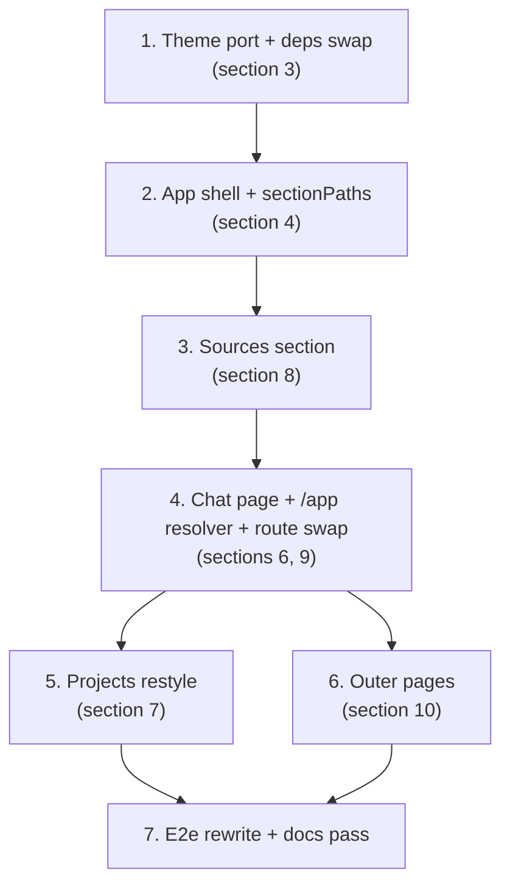

# UI overhaul on the official MUI templates - Design

Date: 2026-10-21
Status: Approved design (2026-10-21 round), amended the same day after a fresh-context
review (Claude Opus 5.5) and two user rulings (sidebar/dropdown URL sync; Tailwind
removal); not yet implemented.
Source of truth: `../../2026-10-06-roadmap.md` (the "slices spec") and this document. Where
they disagree on this slice's topics, this document wins; where it is silent, they govern.
This slice is pure frontend: no backend, API, or database changes.

Supersessions (UI level only - the frozen specs stay as written):

- The S2 layouts (`MarketingLayout`, `AuthLayout`, `DashboardLayout`, `SiteFooter`), the S2
  Devias-style theme, and the S2 Tailwind wiring are replaced by the official MUI template
  ports below.
- S5 design decision 3 (the two-tab project page at `/projects/:projectId`) is replaced by
  the section pages and routing below; the ChatPanel thread logic it introduced is kept.

## 1. Context and goal

The signed-in app is currently a topbar-only layout where `/projects/:projectId` holds a
two-tab page (Ask / Documents). The goal of this slice is a beautiful, intuitive, user
friendly app built on the two free official Material UI templates (v9.5.0):

- **Dashboard template** ("Sitemark"): the app shell - permanent sidebar, topbar, custom
  theme with light/dark color schemes.
- **CRUD dashboard template**: the list-page visual language - toolbar with title, search,
  primary action; styled tables with status chips.

Sources, at template-pinning time: `mui/material-ui` tag `v9.5.0`, paths
`docs/data/material/getting-started/templates/{shared-theme,dashboard,crud-dashboard,marketing-page,sign-in,sign-up}`.
Ports adapt the `.tsx` variants (one file is `.ts`, section 3) to this repo's lint and
typing rules; behavior is ours.

Done-when: a user registers, lands on their default project's sources page inside the new
shell, uploads a file, watches it index, and asks a grounded question in chat - with the
old theme, layouts, and styling infrastructure fully gone, and the whole existing test
story green.

## 2. Decisions (2026-10-21 design round, user-approved; 6, 7, 8 amended post-review)

1. **Full template adoption - theme included.** The `shared-theme` port (section 3)
   replaces the current theme entirely. At the end nothing of the old UI framework
   remains: old theme file, old fonts, old layouts, the Tailwind wiring, and the old
   project tab page are deleted, not kept behind a flag.
2. **The selected project lives in the URL.** Section pages are project-scoped routes;
   the topbar dropdown navigates. There are deliberately **no bare `/sources` or `/chat`
   routes at this stage**: every sources/chat URL is project-scoped (user ruling
   2026-10-21). A cross-project sources listing (`/sources` over the signed-in user's
   visible projects, with an "all-projects" option in the dropdown) is a future feature,
   recorded as a TODO in section 15.
3. **Permanent sidebar with five items, project-scoped links.** Projects, Sources, Chat
   are active; Users and Analytics render disabled with a "Coming soon" chip. Below `md`
   the sidebar becomes the template's temporary drawer behind a topbar hamburger.
   Sources and Chat link to **the URL's project** when one is present, so navigation
   never switches projects under the user; with no project in the URL they link to the
   latest project's section, and with zero projects they are disabled.
4. **Topbar: project selector left, account right; always in sync with the URL.** The
   selector lists the user's visible projects newest-first (latest on top) and always
   shows what the URL carries: the URL's project on project-scoped routes, a "Select
   project" placeholder on `/projects`, and a disabled "No projects" placeholder with
   zero projects. Changing the selection navigates to the same section under the new
   project (keeping deep paths like `/sources/upload`), or to the new project's sources
   page when no section is in the URL. The right side keeps the avatar menu (email,
   disabled "Settings" entry, Sign out) plus the template's light/dark/system mode
   switcher.
5. **Section pages, not tabs.** Projects (create-only restyle), Sources index with the
   "Add source" dropdown, one page per source type (file upload first), and a dedicated
   Chat page (sections 7-9). Project edit/delete stays out of scope (later slice).
6. **Landing resolution: latest chattable project, at an internal `/app` entry.** After
   login/register, on the signed-in landing redirect, and for any straggler URL: the
   newest project with at least one `ready` source item wins; with none chattable the
   user lands on the latest project's sources page; with zero projects, on `/projects`
   (section 6). The resolver lives at the internal `/app` route - it is never linked
   from the UI and immediately redirects.
7. **Outer pages adopt the official templates too.** Landing and /about on the Marketing
   template frame; login on the Sign-in template; register on the Sign-up template
   (section 10).
8. **Minimal dependency delta.** Add `@mui/icons-material`. Keep `@fontsource/inter`
   (the new theme's font). Remove `@fontsource/work-sans` **and the Tailwind wiring**
   (`@tailwindcss/vite` plugin, the `tailwindcss` devDependencies, and the
   `@import "tailwindcss"` in `global.css` - no component uses a Tailwind class today,
   user ruling 2026-10-21). Do not add `@mui/x-charts`, `@mui/x-data-grid`,
   `@mui/x-date-pickers`, `@mui/x-tree-view`, or `dayjs`: they only serve the dashboard
   template's demo widgets (charts, tree, date picker), and this app has no content for
   them yet; each arrives with the slice that needs it.
9. **No backend changes.** Every feature below is served by the existing API; the
   resolver, selector, and lists work purely client-side.

## 3. Theme and design system (full replacement)

Port of `shared-theme` into `web/src/theme/`:

| Ported file | Content |
| --- | --- |
| `AppTheme.tsx` | `createTheme` with CSS variables (`colorSchemeSelector: 'data-mui-color-scheme'`, prefix `template`), color schemes, component customizations; replaces `ThemeProvider` + `createAppTheme` in `App.tsx` |
| `themePrimitives.ts` | Sitemark brand/grey/green/orange/red scales, light and dark `colorSchemes`, Inter typography scale, `shape.borderRadius = 8`, template shadows |
| `customizations/inputs.tsx`, `customizations/navigation.tsx`, `customizations/dataDisplay.tsx`, `customizations/feedback.tsx`, `customizations/surfaces.ts` | The five official component overrides that produce the template look (`surfaces` is the lone `.ts` file at v9.5.0) |
| `ColorModeIconDropdown.tsx` | Light/dark/system switcher (MUI persists the choice); its trigger gets an accessible name (`aria-label="color mode"`) and its menu id is renamed away from the upstream "account-menu", so it cannot be confused with the real account menu; placed in the app topbar and on the marketing and auth frames |

Port rules: `.tsx` variants where they exist (`surfaces.ts` is the exception); type-only
imports use `import type` (the repo compiles with `verbatimModuleSyntax`); `AppTheme`
drops the docs-only `disableCustomTheme` prop and keeps `themeComponents`;
`themePrimitives` drops the unused `getDesignTokens` export.

Deletions: `theme/theme.ts`, `theme/theme.test.tsx`, the Work Sans imports in
`global.css`, and the entire Tailwind wiring - the `@tailwindcss/vite` plugin in
`vite.config.ts`, the `tailwindcss` + `@tailwindcss/vite` devDependencies, and the
`@import "tailwindcss"` in `global.css`. `global.css` keeps only the Inter imports
(400/500/600 - the template's heading weights need 600). `theme.test.tsx` is rewritten
against the port (renders, both schemes, a customization applied).

## 4. App shell (Dashboard template port)

- **`layouts/AppShell`** frames every signed-in route: fixed topbar, permanent `Drawer`
  on `md`+ (the template's `SideMenu` structure), the template's mobile drawer below
  `md`, and a full-height content area. No site footer in the shell.
- **Sidebar** items, top to bottom: wordmark "RAG", then Projects (`FolderRounded`),
  Sources (`UploadFileRounded`), Chat (`ChatBubbleRounded`), Users (`GroupRounded`,
  disabled + "Coming soon"), Analytics (`InsightsRounded`, disabled + "Coming soon").
- **Sidebar links are project-scoped** (decision 3): with `:projectId` in the URL,
  Sources links to `/projects/:id/sources` and Chat to `/projects/:id/chat`; with no
  project in the URL they link to the latest project's section; with zero projects they
  are disabled. The hrefs and the active-item detection come from one shared pure
  module, `web/src/app/sectionPaths.ts`:
  - `projectIdFromPath(pathname): string | null` - the project id the URL carries;
  - `sectionPath(section, projectId): string` - a section's project-scoped path;
  - `activeSection(pathname): "projects" | "sources" | "chat" | null` - Projects active
    only on exactly `/projects`; Sources on `/projects/:id/sources/*`; Chat on
    `/projects/:id/chat`. Prefix rules never let two sections light up at once.
- **Topbar** (template's `AppNavbar` shape): left - the project selector, a `Select`
  styled after the template's `SelectContent`, always in sync with the URL (decision 4);
  right - `ColorModeIconDropdown`, then the avatar menu: email subheader, "Settings"
  disabled with a "Coming soon" chip, "Sign out".
- The sign-out race semantics documented in `UserMenu` and `RequireAuth` are preserved
  unchanged; only presentation moves.

## 5. Routing

All signed-in routes stay behind `RequireAuth` (its guard logic is untouched; it has no
`from`-state today, so replacing the post-auth destinations loses nothing).

| Route | Page |
| --- | --- |
| `/projects` | Projects list (CRUD-style, create-only) |
| `/projects/:projectId/sources` | Sources index - all source items + "Add source" dropdown |
| `/projects/:projectId/sources/upload` | File-upload page - upload UI + that type's items |
| `/projects/:projectId/chat` | Chat page |
| `/projects/:projectId` | Redirect to `.../sources` (old tab page deleted) |
| `/app` | Internal landing resolver (section 6); never linked, immediately redirects |
| `/`, `/about`, `/login`, `/register` | Outer pages (section 10) |

There is no bare `/sources` or `/chat` route (decision 2). Unknown paths - including
stragglers like a stale `/chat` bookmark - fall through the `*` catch-all to `/`, whose
signed-in redirect funnels through `/app`. An invalid or invisible project id (404)
renders the existing "Project not found" state with a link back to `/projects` - no
silent redirect.

## 6. Landing resolution ("latest chattable project")

Definitions:

- **Latest project** = newest `created_at` among the user's visible projects (for a fresh
  registrant: the auto-created "Default project").
- **Chattable project** = at least one source item with status `ready` - the same
  condition that enables the chat input. Projects with items still processing are skipped;
  they qualify once indexing completes.

One resolver, mounted at `/app` and reached from the signed-in funnel (`LandingPage`,
`LoginPage`, and `RegisterPage` navigate to `/app` instead of `/projects` when a session
exists or just started):

1. Fetch `GET /api/projects`, sort newest-first; walk the list in order, fetching each
   project's `GET /api/projects/:id/uploads` with a forced refetch (cached statuses can
   be stale) and stopping at the first project with a `ready` item. A failed uploads
   fetch counts as not chattable; the walk continues.
2. Chattable project found -> its `/projects/:id/chat`.
3. None chattable -> the latest project's `/projects/:id/sources` (exactly the fresh-user
   path: default project, empty sources).
4. No projects at all -> `/projects`, whose empty state carries the create CTA.

While scanning, `/app` renders a light centered spinner inside the shell (not
`BootSplash`, which assumes a full viewport). The chat empty state is reachable only on a
specific project's chat route (sidebar with a project selected, dropdown, deep links) -
it is a page state, never a redirect target.

## 7. Projects page (`/projects`)

CRUD-template list styling, create-only functionality:

- Toolbar: title, client-side name search, "Create project" button (the existing
  `CreateProjectDialog`, unchanged apart from the global theme restyle).
- Table (rounded, outlined card wrapper): Name, Visibility chip, Created. Row name links
  to the project's sources page.
- Today's loading skeleton rows, `EmptyProjects` empty state, error card and stale-data
  snackbar behavior are kept as is.
- No row actions: PATCH/DELETE stay API-only until their own slice.

## 8. Sources section

**Sources index** (`/projects/:projectId/sources`):

- Toolbar: title, filename search, and the **"Add source" button with dropdown menu** of
  source types:
  - **File upload** (`UploadFileRounded`) - active; navigates to the file-upload page.
  - **Website** (`LanguageRounded`) - disabled, "Coming soon" chip.
  - **Google Drive** (`AddToDriveRounded`) - disabled, "Coming soon" chip.
- Below: the table of all the project's source items - today the uploads endpoint, with a
  **Type column** (constant "File upload" for now) so the table is honest today and ready
  for multi-type listings later. Columns: Filename, Type, Status chip, Created. Filename
  links to the item's type page.
- Loading, error, and empty states follow the existing patterns (the uploads-list error
  copy says "Could not load the source items.", replacing the old "document list" copy).

**File-upload page** (`/projects/:projectId/sources/upload`):

- Back-to-sources breadcrumb, then the source-type-specific UI (every source type gets its
  own page with the UI its workflow needs; this is the file-upload one).
- **Upload dropzone**: dashed-border surface, upload icon, "Click or drag files to
  upload", PDF/DOCX up to 25 MB helper text, the existing error Alert. Same client checks
  and endpoint as today's `UploadCard`; drag-and-drop is added. The hidden input keeps the
  accessible name "Upload" and gains the `multiple` attribute. Files upload strictly in
  order; the first failure (client rejection or server error) stops the batch - later
  files are not sent.
- **The project's uploaded file items** below: status chips and the existing 2s polling
  (`useProjectUploads` untouched).

Terminology: the in-app product UI says "sources"/"files" for source items everywhere -
resolving the backlog's "documents" naming note. The landing page's marketing voice
("Your documents, searchable by meaning") and the `EmptyProjects` CTA copy are deliberate
exceptions and stay.

## 9. Chat page (`/projects/:projectId/chat`)

- The existing `ChatPanel` thread (question, grounded answer, cited-sources accordions)
  fills the page, restyled to the template look.
- Readiness derives from the uploads hook: with no `ready` item the page shows the empty
  state ("Upload sources to start asking questions" plus a button to that project's
  sources page - an absolute project-scoped link); live polling flips the panel on the
  moment a file reaches `ready`. There is no separate disabled-input state: the panel
  exists exactly when something is ready.

## 10. Outer pages (official template adoption)

- **Landing (`/`)**: the Marketing template frame - marketing navbar (wordmark, About
  link, mode switcher, "Sign in" / "Get started"), hero with the current headline and
  CTAs, a features section with the existing three steps, and the template's footer.
  Only sections with real content are built - no invented pricing or testimonials.
- **About (`/about`)**: the same marketing frame with the current copy.
- **Login (`/login`)**: the Sign-in template - centered card, wordmark, email/password,
  sign-in button, link to register, mode switcher. All `authSlice`/`sessionActions`/
  `tokenStorage` logic is untouched; only presentation changes.
- **Register (`/register`)**: the Sign-up template - same frame, confirm-password field,
  link to login.

## 11. Migration inventory (the "nothing old remains" guarantee)

| Deleted | Replaced by |
| --- | --- |
| `theme/theme.ts` + `theme/theme.test.tsx` | `theme/` shared-theme port (section 3) |
| Tailwind wiring (`@tailwindcss/vite`, `tailwindcss` devDeps, the `global.css` import) | MUI's `CssBaseline` + theme resets |
| `layouts/DashboardLayout.tsx` (+ test) | `layouts/AppShell` (section 4) |
| `layouts/MarketingLayout.tsx`, `layouts/AuthLayout.tsx`, `layouts/SiteFooter.tsx` (+ tests) | Marketing frame, Sign-in/Sign-up frames (section 10) |
| `features/projects/ProjectPage.tsx` (+ test) | Sources index + file-upload page + Chat page (sections 8-9); the upload/polling test coverage it held is ported to the new pages' tests, not lost |
| `features/uploads/UploadCard.tsx` (card look) | Upload dropzone (section 8); its logic and tests carry over |
| `features/uploads/UploadsTable.tsx` (bare table) | Source items table (section 8); `uploadStatus` chips carry over |
| `@fontsource/work-sans` | Inter only |

Kept untouched (logic): `app/api.ts`, store, `authSlice` + `sessionActions`, all RTK Query
APIs, `useProjectUploads`, `uploadRules`, `uploadStatus`, `tokenStorage`, `RequireAuth`,
`BootSplash`, `CreateProjectDialog` (the global theme restyles it), `EmptyProjects`,
ChatPanel thread logic, and the test infrastructure (`server.ts`, `handlers.ts`,
`test-utils.tsx`). Restyled in place: the four outer pages, `UserMenu`, `App.tsx`,
`AppRoutes.tsx`, `global.css`.

## 12. Testing

No MSW handler changes (the API does not change). Type checking (`tsc -b`) runs in every
task, not only at the end.

- **Theme**: AppTheme renders; the light scheme is default and the dark scheme resolves;
  a customization is visibly applied (e.g. the styled `MenuItem`); the mode switcher has
  an accessible name.
- **sectionPaths**: project id extraction, section paths, and the active rules (including
  "only Sources active on `/projects/:id/sources/upload`").
- **Shell**: the five sidebar items render with Users/Analytics disabled ("Coming soon"
  chips); sidebar Sources/Chat hrefs are project-scoped when the URL has a project, fall
  back to the latest project with none, and are disabled with zero projects; the project
  selector always mirrors the URL (placeholder on `/projects`, disabled "No projects"
  with zero) and navigates on change, keeping deep paths inside a section; the avatar menu
  shows the email, a disabled Settings entry, and signs out.
- **Routing/redirects**: `/projects/:id` -> sources; `/app` resolver -> chattable chat,
  else latest sources, else `/projects`; a failed uploads fetch counts as not chattable;
  stale "queued" caches are refetched; the 404 state is preserved.
- **Pages**: projects search/create; add-source dropdown with the two disabled "Coming
  soon" types; dropzone upload via click and drag-and-drop, including multi-file batches,
  the first-failure-stops-the-batch rule, empty drops, and the server rejection copies
  (409/422/503); items tables render statuses; chat empty-state CTA (absolute link) and
  the live flip to ready; the ported upload/polling coverage (multipart shape, pending
  disable, single tab stop, rejection paths, poll start/stop, error-stops-polling).
- **E2e (Playwright)**: the journey is rewritten for the new flow - register -> land on
  the default project's sources -> upload -> watch status -> chat grounded answer; the
  route-guard enforcement spec keeps its semantics with updated selectors and URLs.

## 13. Risks and mitigations

- **Template-port fidelity under our lint/TS rules** - named imports per file, `import
  type` for type-only imports: mechanical, sources exist for every port.
- **`useColorScheme`/`useMediaQuery` in jsdom** - mockable; existing suites already
  handle MUI media queries.
- **Large diff** - mitigated by the ordered build below and one-concern-per-commit.
- **E2e rewrite touches the CI-critical journey** - the rewrite is a first-class task in
  the plan, not an afterthought.
- **Resolver chattability scan costs one forced uploads query per non-chattable
  project** (sequential walk, stops at the first chattable) - acceptable at current
  project counts; all queries are RTK-cached and reused by the pages. A counts-included
  projects list can come with a later backend slice.

## 14. Implementation order

Tasks 3, 4, 6 are sequential by their route dependencies; task 5 follows 4 (it touches the
projects page's row links, which task 4's route swap makes reachable); task 7 closes the
loop. Every task lands working software.

## 15. Documentation and follow-ups

- `docs/2026-10-19-system-overview.md`: the web section is rewritten after implementation
  (new shell and page inventory; service topology and API table unchanged).
- Roadmap: this slice is appended to the slice table (post-S5 UI restructure, pairing rule
  note: this is a frontend-only slice by explicit user decision); the status line and the
  S7 row's "in the project page" wording are refreshed where they name the old UI.
- Backlog resolutions: the "documents" naming note, the S5 tab-a11y note (tabs no longer
  exist), the S5 "pinned Ask tab could end up disabled" note (same), and the stale S2
  visual-pass note (superseded; a fresh human visual pass on the new UI is recorded as
  its replacement).
- TODO (user, 2026-10-21): a future cross-project sources page - bare `/sources` listing
  all source items across the signed-in user's own visible projects (the same visibility
  rules as `GET /api/projects`), with an "all-projects" option in the project dropdown.
  Not in this slice.
- Backlog residuals recorded with links: project edit/delete UI; Users/Analytics content
  slices (which bring `@mui/x-*` dependencies with them); a per-source-type items
  endpoint when the second source type arrives; the dark-mode flash before the stored
  mode applies (no `InitColorSchemeScript`); the chat thread does not survive leaving
  the chat page (consistent with S5's thread-lost-on-reload philosophy).
