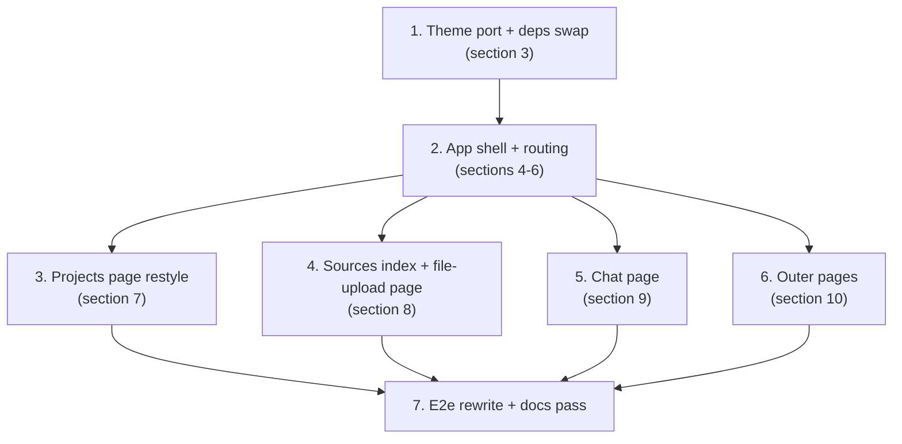

# UI overhaul on the official MUI templates - Design

Date: 2026-10-21
Status: Approved design (2026-10-21 round); not yet implemented.
Source of truth: `../../2026-10-06-roadmap.md` (the "slices spec") and this document. Where
they disagree on this slice's topics, this document wins; where it is silent, they govern.
This slice is pure frontend: no backend, API, or database changes.

Supersessions (UI level only - the frozen specs stay as written):

- The S2 layouts (`MarketingLayout`, `AuthLayout`, `DashboardLayout`, `SiteFooter`) and
  the S2 Devias-style theme are replaced by the official MUI template ports below.
- S5 design decision 3 (the two-tab project page at `/projects/:projectId`) is replaced by
  the section pages and routing below; the ChatPanel thread logic it introduced is kept.

## 1. Context and goal

The signed-in app is currently a topbar-only layout where `/projects/:projectId` holds a
two-tab page (Ask / Documents). The goal of this slice is a beautiful, intuitive, user
friendly app built on the two free official Material UI templates (v9.5.0):

- **Dashboard template** ("Sitemark"): the app shell - permanent sidebar, topbar, custom
  theme with light/dark color schemes.
- **CRUD dashboard template**: the list-page visual language - toolbar with title, search,
  primary action; styled tables with status chips.

Sources, at template-pinning time: `mui/material-ui` tag `v9.5.0`, paths
`docs/data/material/getting-started/templates/{shared-theme,dashboard,crud-dashboard,marketing-page,sign-in,sign-up}`.
Ports adapt the `.tsx` variants to this repo's lint and typing rules; behavior is ours.

Done-when: a user registers, lands on their default project's sources page inside the new
shell, uploads a file, watches it index, and asks a grounded question in chat - with the
old theme and old layouts fully gone, and the whole existing test story green.

## 2. Decisions (2026-10-21 design round, user-approved)

1. **Full template adoption - theme included.** The `shared-theme` port (section 3)
   replaces the current theme entirely. At the end nothing of the old UI framework
   remains: old theme file, old fonts, old layouts, and the old project tab page are
   deleted, not kept behind a flag.
2. **The selected project lives in the URL.** Section pages are project-scoped routes;
   the topbar dropdown navigates (section 5). Rejected: global-state selection (no deep
   links, stale-project risk on refresh) and query-param selection (mutating URLs).
3. **Permanent sidebar with five items.** Projects, Sources, Chat are active; Users and
   Analytics render disabled with a "Coming soon" chip. Below `md` the sidebar becomes the
   template's temporary drawer behind a topbar hamburger.
4. **Topbar: project selector left, account right.** The selector lists the user's
   visible projects newest-first (latest on top), shows the URL's project, and navigates
   to the same section under the newly selected project. The right side keeps the avatar
   menu (email, disabled "Settings" entry, Sign out) plus the template's light/dark/system
   mode switcher.
5. **Section pages, not tabs.** Projects (create-only restyle), Sources index with the
   "Add source" dropdown, one page per source type (file upload first), and a dedicated
   Chat page (sections 7-9). Project edit/delete stays out of scope (later slice).
6. **Landing resolution: latest chattable project.** After login/register, on the signed-in
   landing redirect, and at the `/chat` section root: the newest project with at least one
   `ready` source item wins; with none chattable the user lands on the latest project's
   sources page (section 6).
7. **Outer pages adopt the official templates too.** Landing and /about on the Marketing
   template frame; login on the Sign-in template; register on the Sign-up template
   (section 10).
8. **Minimal dependency delta.** Add `@mui/icons-material`. Keep `@fontsource/inter` (the
   new theme's font). Remove `@fontsource/work-sans`. Do not add `@mui/x-charts`,
   `@mui/x-data-grid`, `@mui/x-date-pickers`, `@mui/x-tree-view`, or `dayjs`: they only
   serve the dashboard template's demo widgets (charts, tree, date picker), and this app
   has no content for them yet; each arrives with the slice that needs it.
9. **No backend changes.** Every feature below is served by the existing API; the
   resolver, selector, and lists work purely client-side.

## 3. Theme and design system (full replacement)

Port of `shared-theme` into `web/src/theme/`:

| Ported file | Content |
| --- | --- |
| `AppTheme.tsx` | `createTheme` with CSS variables (`colorSchemeSelector: 'data-mui-color-scheme'`, prefix `template`), color schemes, component customizations; replaces `ThemeProvider` + `createAppTheme` in `App.tsx` |
| `themePrimitives.ts` | Sitemark brand/grey/green/orange/red scales, light and dark `colorSchemes`, Inter typography scale, `shape.borderRadius = 8`, template shadows |
| `customizations/{inputs,navigation,dataDisplay,feedback,surfaces}.tsx` | The five official component overrides that produce the template look |
| `ColorModeIconDropdown.tsx` | Light/dark/system switcher (MUI persists the choice); placed in the app topbar and on the marketing and auth frames |

Deletions: `theme/theme.ts`, `theme/theme.test.tsx`, the Work Sans imports in `main.tsx`,
and the `@fontsource/work-sans` dependency. `global.css` keeps only generic resets.
`theme.test.tsx` is rewritten against the port (renders, both schemes, customizations).

## 4. App shell (Dashboard template port)

- **`layouts/AppShell`** frames every signed-in route: fixed topbar, permanent `Drawer`
  on `md`+ (the template's `SideMenu` structure), the template's mobile drawer below
  `md`, and a full-height content area. No site footer in the shell.
- **Sidebar** items, top to bottom: wordmark "RAG", then Projects (`FolderRounded`),
  Sources (`UploadFileRounded`), Chat (`ChatBubbleRounded`), Users (`GroupRounded`,
  disabled + "Coming soon"), Analytics (`InsightsRounded`, disabled + "Coming soon").
  Items link to the section roots (`/projects`, `/sources`, `/chat`); the active item
  matches by URL prefix, so `/projects/:id/sources/upload` highlights Sources.
- **Topbar** (template's `AppNavbar` shape): left - the project selector, a `Select`
  styled after the template's `SelectContent`; right - `ColorModeIconDropdown`, then the
  avatar menu: email subheader, "Settings" disabled with a "Coming soon" chip, "Sign out".
- **Selector behavior.** Outside project-scoped routes it shows the latest project;
  changing it navigates to that project's sources page (there is no "same section" to
  preserve on the projects list). Inside a section it swaps the project, keeping the
  section. With no projects it renders disabled with a "No projects" placeholder.
- The sign-out race semantics documented in `UserMenu` and `RequireAuth` are preserved
  unchanged; only presentation moves.

## 5. Routing

All signed-in routes stay behind `RequireAuth` (its guard logic is untouched; it has no
`from`-state today, so replacing the post-auth destinations loses nothing).

| Route | Page |
| --- | --- |
| `/projects` | Projects list (CRUD-style, create-only) |
| `/projects/:projectId/sources` | Sources index - all source items + "Add source" dropdown |
| `/projects/:projectId/sources/upload` | File-upload page - upload UI + that type's items |
| `/projects/:projectId/chat` | Chat page |
| `/projects/:projectId` | Redirect to `.../sources` (old tab page deleted) |
| `/sources` | Redirect to the latest project's `.../sources`; with no projects, the no-project empty state |
| `/chat` | Landing resolver (section 6) |
| `/`, `/about`, `/login`, `/register` | Outer pages (section 10) |

An invalid or invisible project id (404) renders the existing "Project not found" state
with a link back to `/projects` - no silent redirect.

## 6. Landing resolution ("latest chattable project")

Definitions:

- **Latest project** = newest `created_at` among the user's visible projects (for a fresh
  registrant: the auto-created "Default project").
- **Chattable project** = at least one source item with status `ready` - the same
  condition that enables the chat input. Projects with items still processing are skipped;
  they qualify once indexing completes.

One shared resolver, mounted at the `/chat` route and used by the three post-auth
destinations (`LoginPage`, `RegisterPage`, and the signed-in `LandingPage` redirect
navigate to `/chat` instead of `/projects`):

1. Fetch `GET /api/projects`, sort newest-first; walk the list checking each project's
   `GET /api/projects/:id/uploads` (RTK Query cache; the walks on later pages reuse it),
   stopping at the first project with a `ready` item.
2. Chattable project found -> its `/projects/:id/chat`.
3. None chattable -> the latest project's `/projects/:id/sources` (exactly the fresh-user
   path: default project, empty sources).
4. No projects at all -> the no-project empty state ("Create a project" CTA) instead of a
   redirect; the `/sources` root shares it.

The `/sources` root is the simpler sibling: latest project's sources, else the same
no-project state. The chat empty state remains reachable on any specific project's chat
route (dropdown selection, deep links) - it is a page state, not a redirect.

## 7. Projects page (`/projects`)

CRUD-template list styling, create-only functionality:

- Toolbar: title, client-side name search, "New project" button (existing
  `CreateProjectDialog`, restyled to the template look).
- Table (rounded, outlined card wrapper): Name, Visibility chip, Created.
- Today's loading skeleton rows, `EmptyProjects` empty state (restyled), error card and
  stale-data snackbar behavior are kept as is.
- No row actions: PATCH/DELETE stay API-only until their own slice.

## 8. Sources section

**Sources index** (`/projects/:projectId/sources`):

- Toolbar: title, filename search, and the **"Add source" button with dropdown menu** of
  source types:
  - **File upload** (`UploadFileRounded`) - active; navigates to the file-upload page.
  - **Website** (`LanguageRounded`) - disabled, "Coming soon" chip.
  - **Google Drive** (`AddToDriveRounded`) - disabled, "Coming soon" chip.
- Below: the table of all the project's source items - today the uploads endpoint, with a
  **Type column** (constant "File upload" for now) so the table is honest today and ready
  for multi-type listings later. Columns: Filename, Type, Status chip, Created. Filename
  links to the item's type page.
- Loading, error, and empty states follow the existing patterns.

**File-upload page** (`/projects/:projectId/sources/upload`):

- Back-to-sources breadcrumb, then the source-type-specific UI (every source type gets its
  own page with the UI its workflow needs; this is the file-upload one).
- **Upload dropzone**: dashed-border surface, upload icon, "Click or drag files to
  upload", PDF/DOCX up to 25 MB helper text, the existing error Alert. Same client checks
  and endpoint as today's `UploadCard`; drag-and-drop is added and accepts one or more
  files, uploaded sequentially with the first rejection surfaced.
- **The project's uploaded file items** below: status chips and the existing 2s polling
  (`useProjectUploads` untouched).

Terminology: the UI says "sources"/"files" everywhere - resolving the backlog's
"documents" naming note.

## 9. Chat page (`/projects/:projectId/chat`)

- The existing `ChatPanel` thread (question, grounded answer, cited-sources accordions)
  fills the page, restyled to the template look.
- Readiness derives from the uploads hook: with no `ready` item the page shows the empty
  state ("Upload sources to start asking questions" plus a button to that project's
  sources page), and the input stays disabled while uploads are in flight; live polling
  flips the panel on the moment a file reaches `ready`.

## 10. Outer pages (official template adoption)

- **Landing (`/`)**: the Marketing template frame - marketing navbar (wordmark, About
  link, mode switcher, "Sign in" / "Get started"), hero with the current headline and
  CTAs, a features section with the existing three steps, and the template's footer.
  Only sections with real content are built - no invented pricing or testimonials.
- **About (`/about`)**: the same marketing frame with the current copy.
- **Login (`/login`)**: the Sign-in template - centered card, wordmark, email/password,
  sign-in button, link to register, mode switcher. All `authSlice`/`sessionActions`/
  `tokenStorage` logic is untouched; only presentation changes.
- **Register (`/register`)**: the Sign-up template - same frame, confirm-password field,
  link to login.

## 11. Migration inventory (the "nothing old remains" guarantee)

| Deleted | Replaced by |
| --- | --- |
| `theme/theme.ts` + `theme/theme.test.tsx` | `theme/` shared-theme port (section 3) |
| `layouts/DashboardLayout.tsx` (+ test) | `layouts/AppShell` (section 4) |
| `layouts/MarketingLayout.tsx`, `layouts/AuthLayout.tsx`, `layouts/SiteFooter.tsx` (+ tests) | Marketing frame, Sign-in/Sign-up frames (section 10) |
| `features/projects/ProjectPage.tsx` (+ test) | Sources index + file-upload page + Chat page (sections 8-9) |
| `features/uploads/UploadCard.tsx` (card look) | Upload dropzone (section 8); its logic and tests carry over |
| `features/uploads/UploadsTable.tsx` (bare table) | Source items table (sections 7-8); `uploadStatus` chips carry over |
| `@fontsource/work-sans` | Inter only |

Kept untouched: `app/api.ts`, store, `authSlice` + `sessionActions`, all RTK Query APIs,
`useProjectUploads`, `uploadRules`, `uploadStatus`, `tokenStorage`, `RequireAuth`,
`BootSplash`, `CreateProjectDialog`, `EmptyProjects`, ChatPanel thread logic, and the
test infrastructure (`server.ts`, `handlers.ts`, `test-utils.tsx`). Restyled in place:
the four outer pages, `UserMenu`, `App.tsx`, `AppRoutes.tsx`, `main.tsx`.

## 12. Testing

No MSW handler changes (the API does not change).

- **Theme**: AppTheme renders; light and dark schemes resolve; a customization is visibly
  applied (e.g. the styled `MenuItem`).
- **Shell**: the five sidebar items render with Users/Analytics disabled and chipped; the
  project selector lists projects newest-first, defaults correctly, and navigates on
  change (same-section swap inside a section, sources from the projects list); the avatar
  menu shows the email, a disabled Settings entry, and signs out.
- **Routing/redirects**: `/projects/:id` -> sources; `/sources` -> latest; `/chat` resolver
  -> chattable chat, else latest sources; no-project empty state; 404 state preserved.
- **Pages**: projects search/create; add-source dropdown with the two disabled "Coming
  soon" types; dropzone upload via click and drag-and-drop (including multi-file and
  rejection); items tables render statuses; chat empty-state CTA, disabled input while
  indexing, and the live flip to ready.
- **E2e (Playwright)**: the journey is rewritten for the new flow - register -> land on the
  default project's sources -> upload -> watch status -> chat grounded answer; the
  route-guard enforcement spec keeps its semantics with updated selectors.

## 13. Risks and mitigations

- **Template-port fidelity under our lint/TS rules** - named imports per file, no
  default-export surprises: mechanical, `.tsx` sources exist for every port.
- **`useColorScheme`/`useMediaQuery` in jsdom** - mockable; existing suites already
  handle MUI media queries.
- **Large diff** - mitigated by the ordered build below and one-concern-per-commit.
- **E2e rewrite touches the CI-critical journey** - the rewrite is a first-class task in
  the plan, not an afterthought.
- **Resolver chattability scan costs one uploads query per non-chattable project** -
  acceptable at current project counts; all queries are RTK-cached and reused by the
  pages. A counts-included projects list can come with a later backend slice.

## 14. Implementation order

Tasks 3-6 are independent of each other and may be parallelized; each lands with its
component tests, task 7 closes the loop.

## 15. Documentation and follow-ups

- `docs/system-overview.md`: the web section is rewritten after implementation (new shell
  and page inventory; service topology and API table unchanged).
- Roadmap: this slice is appended to the slice table (post-S5 UI restructure, pairing rule
  note: this is a frontend-only slice by explicit user decision).
- Backlog resolutions: the "documents" naming note, the S5 tab-a11y note (tabs no longer
  exist), and the stale S2 visual-pass note (superseded; a fresh human visual pass on the
  new UI is recorded as its replacement).
- Follow-ups recorded with links: project edit/delete UI; Users/Analytics content slices
  (which bring `@mui/x-*` dependencies with them); a per-source-type items endpoint when
  the second source type arrives (the sources index currently rides the uploads
  endpoint).
